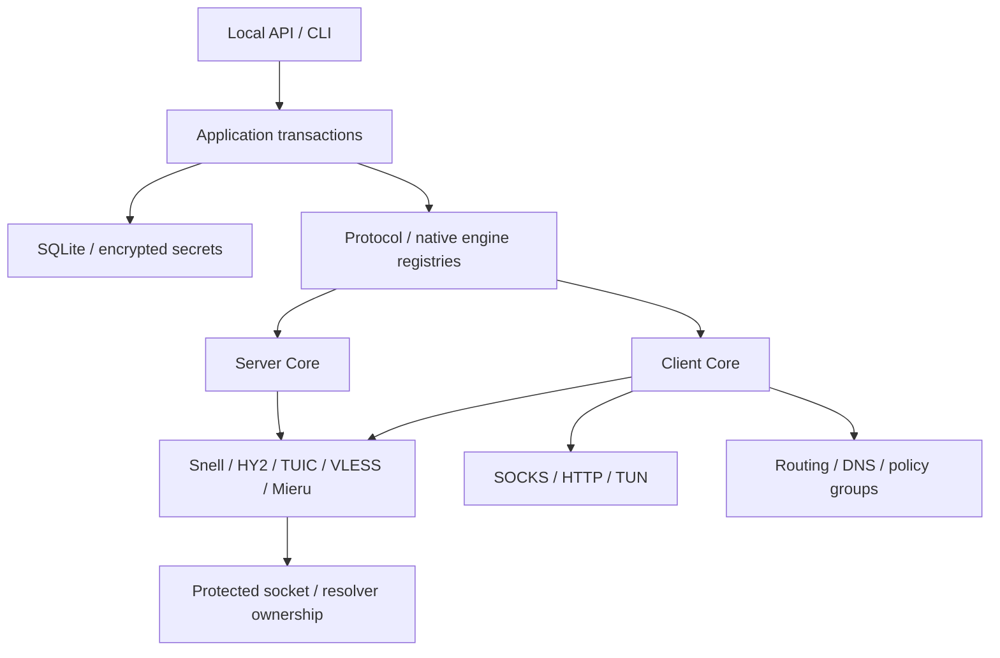

# Splicore architecture

Documentation status: Current architecture correction
Audience: Maintainers and operators
Last reviewed: 2026-10-04
Owner: Splicore maintainer
Responsibility: Independent native Server + Client Core boundary
Lifecycle: Experimental; Phase 14 local freeze

Splicore is an independent Server + Client Core with one shared control plane.
The maintainer's boundary is authoritative; [ADR 0035](adr/0035-xray-runtime-removed-from-core.md)
supersedes the historical Phase 6/7 Xray runtime direction.

## Core boundaries

Domain models own protocol identity, Account/Binding, credential scope,
RemoteNode, Outbound, client profile, routing/DNS/policy and providers. Ports keep
runtime, repository, cipher and transport dependencies explicit. Application
services validate canonical intent and drive Prepare/Commit/Activate. SQLite
and transport adapters are replaceable boundaries.

`Protocol != Engine` remains a useful abstraction. Current EngineID is native
only; the principle does not imply ownership of another core. Native adapters
reuse inherited runtime APIs and official embedded Mieru v3.38.0. Protocol wire,
framing and cryptography stay upstream. See [SDK](architecture/PROTOCOL_SDK.md).

Server and Client both support Snell, Hysteria2, TUIC, native VLESS and Mieru as
Experimental profiles. DIRECT/REJECT remain builtins. VLESS plain/TLS/REALITY
flow-none stays supported; Vision is Deferred/Unsupported. FinalMask and Sudoku
are out of scope. [Capability matrix](architecture/CAPABILITY_MATRIX.md).

## Lifetime and transactions

An immutable client generation owns routing/DNS/policy state, local ingress,
underlay leases and adapter references. Connections retain their generation;
old references retire only after session completion. Replacement prepares a
candidate, durably commits SQLite, then publishes atomically. Failed prepare or
commit retains working listeners, credentials and provider validators.

Servers keep per-generation admission and attributed binding counters. Export
requires an enabled account/binding and exposes only client credentials/public
trust material. Credentials are encrypted with owner/schema AAD. Server-only
REALITY private keys never cross the ClientProfile boundary.

Phase 14 imports/providers retain persistent UUID identity, encrypted remote
source/auth/validators, bounded single-use previews, revision checks, serialized
refresh and a four-worker fake-clock scheduler. Referenced disappeared nodes
remain stale and usable; disable refuses new sessions. Proxy and RuleSet feeds
swap atomically. Protected fetches use DIRECT/outbound/group and reject cycles.
Retired Xray/mask imports are classified Unsupported and never stripped into a
runnable ordinary node. [Provider model](architecture/PROVIDER_MODEL.md).

## Host integration and underlay

Logical routing chooses an action before underlay protection. Protected providers
own numeric endpoint snapshots, socket controls and resolvers. Production egress
inventory covers DIRECT, bootstrap/upstream DNS, health, all five native clients,
native server targets and provider HTTP. Unknown callsites fail the audit.

TUN, dynamic DNS, old generations/shared refs/reused TUN, Wintun and
journal ownership remain. No external-child underlay hooks remain: they had no
other current user. Real Windows host mutation and native Ubuntu auto-route
qualification remain limited to the existing local evidence. See
[system integration](SYSTEM_INTEGRATION.md).

## Distribution and legacy state

One `splicore` binary and one `splicore.service` own the product. There is no
Xray binary, download/pin/checksum, runtime directory requirement, child supervisor,
process/PID management, runtime rendering or health/API/doctor surface.
Mieru is embedded; no external runtime is required.

Existing generic engine fields are preserved. Preflight rejects retired Xray or
mask records before forward migrations or installed file replacement, with an
explicit diagnostic and intact state. Native-only old builds can upgrade. The
installer can strip retired bootstrap/receipt metadata after successful preflight;
failure restores the old installation. Historical migrations remain immutable.
[Distribution](DISTRIBUTION.md), [upgrade](UPGRADE.md).

## Future orchestration

NoBrand-OneClick will choose independent Splicore for native supported profiles
or independent Xray for specialized VLESS FinalMask/Sudoku. NoBrand owns artifact
verification and lifecycle of each deployed core. Splicore does not know another
service's state. This task updates only Splicore design docs; the real NoBrand
repository remains untouched. [Boundary design](integration/NOBRAND_MIGRATION.md).

## History and current work

These anchors preserve links from the immutable Phase 3/4 evidence. Their
historical protocol/engine dispositions are superseded by the current native
architecture and capability matrix above.

Phase 0–13 frozen history/reports remain unchanged. Phase 14 provider work and the
architecture correction are accepted in the [local freeze](reports/PHASE_14_FREEZE_REPORT.md).
The [correction report](reports/ARCHITECTURE_CORRECTION_XRAY_BOUNDARY_REPORT.md)
records source/runtime audits, native regressions, package sizes and exact
platform limits. [Development context](DEVELOPMENT_CONTEXT.md).
