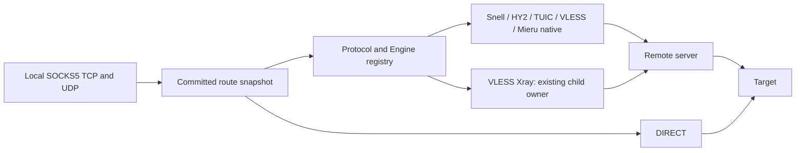

# Client Runtime

- Documentation status: Canonical
- Audience: Core, client and engine developers
- Last reviewed: 2026-10-03
- Owner: Core maintainers
- Responsibility: Client intent, adapters, socket ownership and runtime recovery.
- Lifecycle: Update with client domain or lifecycle changes.

## Experimental Phase 12 boundary

One daemon runs server and client roles with shared SQLite, Application, encrypted
credentials, journal, registries, API and CLI. Loopback SOCKS5 supports TCP CONNECT
and UDP ASSOCIATE. Ordered routing, policy groups and managed DNS are Experimental. TUN, subscriptions and providers are deferred.

## Canonical resources and adapter registry

| Resource | Ownership and authority |
| --- | --- |
| RemoteNode | Immutable ID, original endpoint, protocol, credential reference, public transport/security and bounded options. |
| Credential | Existing generic encrypted payload owned by one Account, server Inbound or RemoteNode. |
| Outbound | Independent ID and NodeID/EngineID references; a VLESS node can back both engines. |
| LocalInbound | Loopback SOCKS listener, separate from server Inbound. |
| ProfileState | Committed intent and shared global revision. |
| Session | Ephemeral TCP stream or UDP association owning a generation reference. |

`internal/splicore/domain/client/client.go` validates and deep-copies intent.
References reject unsafe deletion. Limits: 128 nodes, 129 outbounds including
DIRECT, 32 listeners and 4096 accepted sessions. ClientProfile is an export
projection; exporter strings never become runtime input. ClientTLS is shared
public material only, with no field for server private keys.

The immutable registry maps exact protocol/engine pairs to six adapters:
Snell/native, HY2/native, TUIC v5/native, VLESS/native, VLESS/xray and Mieru/native.
Protocol-owned options/credentials are reused. Unsupported pairs reject without
fallback. VLESS flow-none supports plain/TLS/REALITY. Vision rejects under ADR 0017;
client FinalMask/Sudoku is deferred and frozen server features remain.

## Embedded and child ownership

Each inherited native adapter owns a private Box/context. Mieru uses official
v3.38.0 Client APIs and a private profile/mux, with no external mita. Its socket
owner tracks logical/raw sockets, cancels pending dials and joins injected operations
before Stop. The SDK sets a process-wide quiet formatter and shares cipher/metrics
facilities; global counters never enter accounting. Client APIs start no signals,
RPC daemon or singleton runtime. Stop joins mux maintenance but exposes no client
event-loop join; raw socket close drives exit, checked by repeated stack evidence.

Xray server/client share one Engine, handles registry, pinned validation, process
owner, reaper and artifact cleanup. Client generations expose only private loopback
SOCKS TCP/UDP. The private packet projection uses the existing decoder and retains
FQDNs. Client artifacts contain UUID/public fields only, with 0600/0700 permissions.
The private TCP projection exposes the stream contract without promising end-to-end
CloseWrite through every VLESS server. Application EOF closes that owned tunnel;
TCP half-close is not qualified for this adapter. DIRECT retains its half-close contract.
Explicit CA trust renders a custom-only Xray root pool on both platforms. Windows
private SOCKS ports are reserved as a complete TCP/UDP pair; bounded candidate
selection accounts for separate port exclusions before any child is created.

## Leases and transactions

Immutable generations are published atomically after commit. Each generation owns
reference-counted adapter leases; each session retains its generation. Effective
node/outbound/credential settings select reuse. Labels, metadata and route changes
reuse unchanged adapters; endpoint/credential changes rebuild only affected leases.
Abort releases candidate references. Explicit restart forces rebuild and closes old
sessions after commit. TCP streams survive normal reconcile on their old generation;
UDP associations also retain their old graph/member across route/adapter changes. Passive health
belongs to a lease, preventing retired traffic from affecting replacement health.

Narrow locks protect refs/admission/maps; payload I/O takes no manager lock. Counters
are atomic, buffers belong to each direction/flow and no unsafe pointer is introduced.
Shared revision/HMAC/pending/build/bind/commit/publication semantics remain. SQL has
no network I/O. Failure closes candidates and preserves committed state/server roles.

## SOCKS UDP association ownership

Each control TCP connection owns one ephemeral UDP relay on the listener's loopback
IP. Requested IP must equal the TCP peer; requested source port is fixed or pinned
by the first valid nonfragmented datagram. Foreign IP/port, invalid RSV and FRAG are
discarded. Fragments cannot claim the port. There are at most 32 independent target
flows. Adapters provide packet I/O with normal SOCKS framing.

The association owns its receive buffer; each flow worker owns another. Pool encoding
copies before release. Control EOF, two-minute idle expiry, listener removal, explicit stop/restart or shutdown
cancels admission, closes sockets, joins workers and finally releases the generation.
Flow creation/WaitGroup.Add finish before cleanup Wait. Pending dials are bounded.

With managed DNS disabled, Phase 11 semantics remain:

| UDP domain target | Resolution |
| --- | --- |
| DIRECT | Standard local net.Dialer per flow. |
| Snell/native | Local per flow; frozen response framing requires IPs. |
| Mieru/native | Local per flow; official response wrapper accepts IP headers. |
| HY2/TUIC/VLESS native or Xray | Remote protocol resolution, retaining FQDNs. |

Canonical domains remain unchanged. TCP proxy targets resolve remotely. Mieru TCP
underlays retain the original server domain for normal net.Dialer address selection.
Managed DNS centralizes resolution while preserving original domain metadata. See
[DNS](DNS_MODEL.md), [routing](ROUTING_MODEL.md) and [policy](POLICY_MODEL.md).
FakeIP/interception remains deferred.

## Recovery, stats and health

Schema 6 restores clients after server recovery in the same unit. Client socket/build
failure marks degraded while server/API remain live. Offline nodes do not prevent
startup and affect only their lease; next connections recover without daemon restart.
Shutdown cancels operations, closes sockets and joins owned workers. Handshake/remote
dial deadlines are five seconds; deterministic tests use idle notifications.

ClientTrafficStats separates TCP total/active sessions, UDP total/active associations,
upload/download packets and application payload bytes. Eight fields are decimal
strings. Headers/control/framing are excluded. Node/Outbound/LocalInbound/Session are
views of the same payload; never sum dimensions. Counters are ephemeral, without
durable usage/enforcement. Passive configured/available/active/error is observation,
not a probe.

See [storage](STORAGE_MODEL.md), [security](SECURITY_BOUNDARIES.md), [API](../api/README.md),
[CLI](../CLI.md), [operations](../OPERATIONS.md), [ADR 0023](../adr/0023-client-udp-ownership.md)
and the [acceptance report](../reports/PHASE_11_CLIENT_OUTBOUND_EXPANSION_REPORT.md).

## Phase 12 graph ownership

ProfileState.network stores canonical routes/sets/groups/DNS. Complete graph compilation
precedes commit and atomic publication. Active schedulers stop/join on retirement;
established TCP/UDP retain old network/adapters until final release. Shutdown tracks
every live generation owner, including a retired generation held only by an API DNS
query, and cancels/joins all query sockets. Groups own narrow locked observations and
atomic RR counters; UDP affinity belongs to one association. No shared scratch buffer,
global payload mutex or unsafe pointer is introduced.

Malformed committed network JSON/references report client_committed_state_invalid and
degraded health without deleting intent or disabling server/control. Restore a verified
backup before importing valid configuration through Application.
