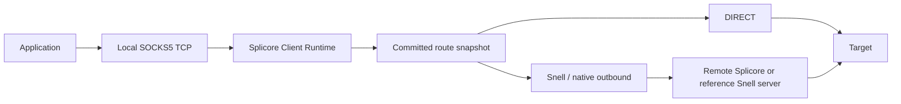

# Client Runtime

- Documentation status: Canonical
- Audience: Core, client and engine developers
- Last reviewed: 2026-10-02
- Owner: Core maintainers
- Responsibility: Client intent, adapters, socket ownership and runtime recovery.
- Lifecycle: Update with client domain or lifecycle changes.

## Experimental Phase 10 boundary

One Splicore process runs server and client runtimes. The existing Application,
registries, encrypted credentials, transaction journal, API, CLI and SQLite remain
shared. Client traffic is embedded in Splicore; no external client process is used.

## Canonical resources

| Resource | Meaning and authority |
| --- | --- |
| RemoteNode | Remote resource: immutable UUID, renameable name, ProtocolKey, host/port, credential reference, typed transport/security, schema-versioned adapter options and metadata. |
| Credential | Generic encrypted record owned by exactly one Account, server Inbound or RemoteNode. Remote PSK is never a Node field. |
| Outbound | Independent immutable ID, name, kind and NodeID/EngineID references. Builtin `direct` is an OutboundID; it is not a ProtocolID. |
| LocalInbound | Client-facing SOCKS5 listener with its own UUID, listen endpoint and optional selected outbound. Separate from server Inbound. |
| ProfileState | Committed enabled flag, nodes/outbounds/local listeners/default route and the shared global revision. |
| Session | Ephemeral connection identity, local/outbound/node references and payload counters; never a server Binding. |

`internal/splicore/domain/client/client.go` owns validation and deep copies.
References use IDs. Rename preserves credentials and routes. Referenced nodes and
outbounds reject deletion. Limits: 128 nodes, 129 outbounds including DIRECT,
32 local listeners, 4096 concurrent accepted sessions. No bulk importer is implemented;
future importers must produce the same canonical resources.

Exported ClientProfile remains a separate third-party-client projection. It has
neither client runtime identity nor routing/health authority. Runtime adapters
consume canonical node settings and credentials through ports; generated native
configuration is an artifact, never persistent authority.

## Adapter boundary

An immutable outbound registry maps exactly `(ProtocolID, EngineID)` to an
OutboundFactory. Unsupported pairs reject; no fallback. Snell/native is the first
registered proxy adapter. DIRECT is a protocol-neutral builtin runtime dialer.
The existing native engine embeds the inherited Snell outbound in a privately owned
Box. The frozen server-v5/client-v4 and v6/v6 mapping is shared with export; other
versions reject. There are no upstream runtime or wire edits.

Remote Snell UDP is implemented through the optional ClientPacketDialer port and
tested separately. Local SOCKS UDP ASSOCIATE is **DEFERRED**, returning SOCKS reply 7.
Local SOCKS TCP CONNECT is supported. Inherited Snell EOF behavior may close the
tunnel on command-1 half-close; Phase 10 does not extend that wire contract. Fixed
length full duplex payload tests verify bytes before closing the application.

## Lifetime and synchronization

Control changes build an immutable route/outbound generation and publish it through
an atomic pointer after commit. A narrow lock protects acquiring a generation
reference against retirement. Each session owns a reference; retired adapters close
when the last reference is released. Counter pointers are fixed before publication;
removed resources are pruned without invalidating old sessions. A bookkeeping mutex
protects listener/session maps and remote socket assignment. Payload I/O holds no
manager lock. Each copy direction owns its buffer; no shared scratch/pool reuse or
unsafe pointer is introduced. Passive health is one atomically published immutable
available/error pair.

Creation sequence: validate references/credentials, HMAC plan at the global revision,
persist pending journal, build adapters, bind candidate sockets with admission closed,
commit encrypted intent, publish generation and open admission. SQL callbacks have
no network I/O. Failure closes candidates and compensates the pending journal,
preserving committed state and existing sessions. An unavailable remote is observed
passively during real traffic; startup never probes nodes.

Route/credential changes retain established sessions on the prior generation. Stop
commits disabled state, closes listeners/sessions and releases ports. Start reconstructs
the committed enabled state. Restart is one transaction: rebuild adapters, preserve
unchanged healthy bound sockets, then close old sessions after successful commit.
Daemon shutdown cancels pending dials, closes local/remote sockets and waits for owned
workers. Handshake and remote dial deadlines are five seconds. Notification-based
idle waiting is used for deterministic tests.

## Recovery, stats and health

SQLite schema 5 restores the client after server recovery in the same daemon/unit.
Client socket/build restoration failure marks the client degraded and leaves server
and API running. Corrupt committed state remains a storage error. A remote refusal
does not disable DIRECT, the server or management APIs. New SOCKS connections can
reconnect without restarting Splicore.

LocalInbound, Outbound, Node and active Session observations count successful payload
bytes, total sessions and active sessions. These are multiple views of the same
traffic; **do not add them for usage or billing**. Counters are process-local, with
no durable accounting or enforcement. Outbound health reports configured, available,
active and a fixed redacted last-error code. Availability begins false and is set by
successful downstream payload; it describes the last observation, not an active probe.

See [routing](ROUTING_MODEL.md), [storage](STORAGE_MODEL.md), [security](SECURITY_BOUNDARIES.md),
[API](../api/README.md), [CLI](../CLI.md), [operations](../OPERATIONS.md) and
[ADR 0022](../adr/0022-client-runtime-domain.md).
