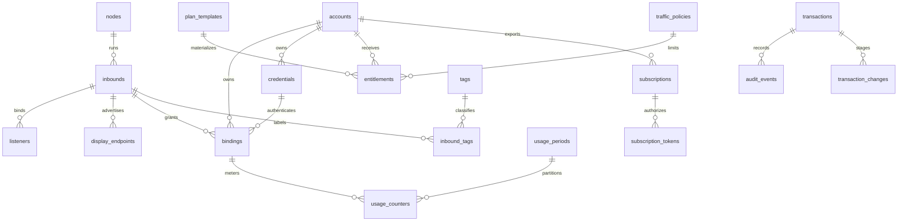

# Database ERD and staged table plan

- Documentation status: Canonical
- Audience: Domain and storage developers
- Last reviewed: 2026-10-01
- Owner: Storage / Core maintainers
- Responsibility: Logical entities, relationships, ownership and constraints; not schema migration history.
- Lifecycle: Update with relevant design/code changes under the documentation policy.

This document owns logical entities, relationships, ownership and constraints.
[Storage](STORAGE_MODEL.md) owns durability, migration mechanics and backups;
migration files own actual schema history. Do not copy a full SQL schema
into multiple Markdown documents.

The complete ERD below remains the logical target. Foundation SQL is owned by
[0001_initial](../../internal/splicore/storage/sqlite/migrations/0001_initial.sql).
IDs are stored as random UUID
TEXT with consistent format. Timestamps UTC; counters/revisions signed 64-bit
integers with overflow checks; API emits large counters/revisions as decimal strings.
Booleans constrained 0/1, status values checked, typed extension JSON schema-versioned
and validated. Secret data is encrypted BLOB, never generic metadata JSON.

| Table | Minimum important columns/constraints | Stage |
|---|---|---|
| nodes | id PK, instance identity metadata; one local installation | Phase 1 |
| accounts | id PK, name, status, enabled, expires_at, metadata, revision | Phase 1 |
| operators | id PK, auth reference, state; no Account FK conflation | Future RBAC; actor identity in audit now |
| inbounds | id PK, node_id FK, protocol/wire/settings schema, internal engine, enabled, revision | Phase 1 |
| listeners | id PK, inbound_id FK, transport/address/port/namespace; app validates wildcard/family overlap | Phase 1 |
| display_endpoints | id PK, inbound_id FK, host/port/family/priority | Phase 1 |
| credentials | id PK, account_id nullable FK, kind/schema, ciphertext/key_id, state/validity/revision | Phase 1 |
| bindings | id PK, account_id/inbound_id/credential_id FKs, enabled, override, revision; UNIQUE(account_id,inbound_id) for initial model | Phase 1 |
| traffic_policies | id PK, integer ceilings/reset/timezone/session constraints | Phase 1 |
| plan_templates | id + version PK, selector/policy defaults | Future template UI; direct entitlement now |
| entitlements | id PK, account_id FK, template version nullable, policy snapshot/selector/validity; one active per account | Future entitlement stage |
| subscriptions | id PK, account_id FK, formats/selector/enabled/expiry/revision | Future subscription stage |
| subscription_tokens | id PK, subscription_id FK, digest UNIQUE, generation, expiry/revocation | Future subscription stage |
| usage_periods | id PK, account_id FK, reset policy snapshot, UTC start/end, settlement state; UNIQUE account/boundaries | Future accounting stage |
| usage_counters | leaf account/binding/inbound/node/protocol dimensions, period_id, up/down/connections, quality | Future accounting stage |
| usage_sources | source/instance/generation + cursor, last counters; UNIQUE source epoch/cursor ingestion | Future accounting stage |
| quota_reservations | id PK, account/period/source/budget lease, reserved/settled/uncertain | Phase 1 if strict quota enabled |
| tags / inbound_tags | tag id/name UNIQUE; junction composite PK | Future selector stage; bounded Inbound JSON tags now |
| resource_groups | id PK, selector/schema/revision, references cycle-checked | Future named selectors |
| transactions | id PK, actor/request/idempotency, base/target generation, plan digest, state, timestamps/redacted error | Phase 1 |
| transaction_changes | transaction/resource FK, candidate typed data and secret references; committed resource rows unchanged until commit | Future runtime coordinator |
| audit_events | id PK, transaction/actor/action/resource/old-new revision/request/timestamp/result, redacted fields | Future audit persistence; typed event contract now |
| settings | key PK, committed generation pointer/import ownership mappings; not duplicated bootstrap settings | Phase 1 |
| schema_migrations | version PK, checksum, applied_at, tool version | Phase 1 |

Ownership constraints include Binding credential Account matching and protocol-kind
matching (application validation within writer transaction). Credentials for shared
server keys are inbound-owned secret records, never assigned as Account credentials.
Use explicit joins/indexes on Binding account/inbound, credential owner, usage
account/period and binding/time, transaction state, subscription digest/expiry.
Credentials with null owner require explicit server scope; deny arbitrary null ownership.

On delete, use RESTRICT for live references and preserve accounting/audit via
tombstones; no cascade removing history. Scoped import ownership mapping is
`(owner_scope, import_key, resource_type) → id`, unique and revisioned. Candidate
state has transaction ownership; settings.committed_generation switches with
resource updates and audit success in **one** SQLite transaction.

## Foundation schema scope

Schema 1 contains schema_migrations, metadata, nodes, settings, accounts,
inbounds, listeners, display_endpoints, credentials, bindings, traffic_policies
and transactions. Checks/FKs and unique Account/Inbound binding enforce basic
ownership; the writer checks credential owner/state/protocol kind in the same
transaction. Pending journal identity is separate from unpublished resource rows.
Global committed revision and successful transaction state change together.

This narrower scope follows the explicit Phase 1 request, replacing earlier
Phase 1 table staging recommendations. Entitlements, usage, candidate change
records and audit tables are deferred. No payment/order tables exist.
