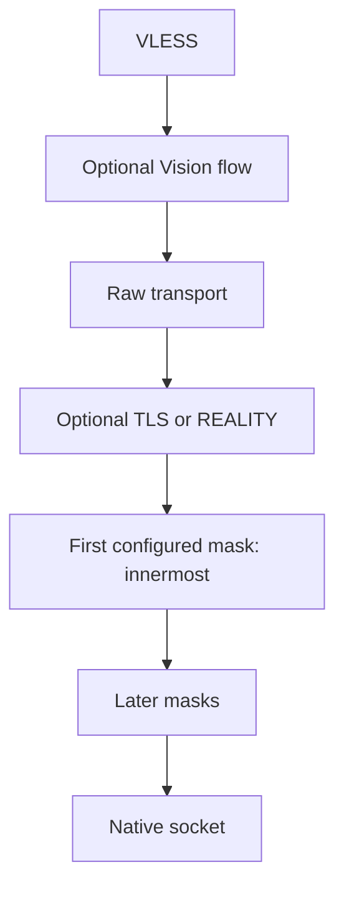

# Native TCP FinalMask

`internal/splicore/domain/finalmask` owns bounded intent.
`internal/splicore/finalmask` wraps `net.Conn` independently of VLESS. VLESS is
currently the admitted protocol consumer; other protocols reject this configuration
until their composition is integrated. There is no external core process.

## Placement and order



Inbound reverses the path. A configured array `[A, B, C]` yields socket bytes
`C(B(A(security_bytes)))`. Wrappers are constructed in reverse array order.
Vision direct copying retains this underlay. Every wrapper delegates addresses,
deadlines, CloseRead and CloseWrite; shutdown interrupts delayed writes.

Server: `settings.stream_transport.final_mask.tcp[]`.
Client: `node.transport.final_mask.tcp[]`.
Only raw TCP admits this field. Mask types and settings are a bounded native configuration contract.

```json
{
  "kind": "tcp",
  "final_mask": {
    "tcp": [
      {"type": "fragment", "settings": {
        "packets": "tlshello", "lengths": ["17-31"], "delays": [0], "maxSplit": 32
      }},
      {"type": "sudoku", "settings": {
        "password": "<table selector>", "ascii": "prefer_entropy",
        "paddingMin": 10, "paddingMax": 40
      }}
    ]
  }
}
```

## header-custom

`clients`, `servers`, `errors` are arrays of packet sequences. Each sequence is
an array of items: `delay`, `rand`, `randRange`, `packet`, `type`.
Packet encodings are numeric `array` (default), `str`, `hex`, `base64`.
Random packets specify a count and optional byte range (default 0–255), and cannot
also specify a packet. The client sends a client sequence then receives its paired
server sequence; the server does the reverse. Remaining server sequences follow.
A failed client match may trigger its error sequence. Static bytes must match;
random bytes are consumed by size. After the handshake the stream is transparent.
Delay is milliseconds; zero merges packets with the preceding sequence write.
Capture/reuse/transform expressions are unsupported and explicitly rejected.

## fragment

`packets` is empty for all writes, a positive write-index range, or `tlshello`
for the first complete TLS handshake record. `lengths` and `delays` contain
integer or string ranges; the last entry is reused. Singular `length`/`delay`
aliases are accepted when their plural form is absent; conflicting forms reject.
`maxSplit` is a range, with zero selecting the native maximum of 4096 splits.
TLSHello mode rebuilds valid TLS record headers and forwards any following bytes.
A sole zero delay merges the generated TLS records into one underlying write.
It recognizes ClientHello record headers, not an arbitrary leading byte 22.
When Sudoku is an inner mask, an outer `tlshello` fragment passes its encoded
bytes through unchanged; use stream fragmentation to split that opaque stream.

Ranges must be ordered, nonnegative and free of overflow. The last length's
minimum must be positive. Earlier zero lengths are allowed and count toward the
split limit. Fragment lengths are bounded to 65535 bytes, lists to 64 entries,
individual delays to 30000 ms, and configured splits to 4096. Delays observe live
write deadlines and Close; they cannot hold shutdown indefinitely. A failed
transformed write is terminal, so an incomplete transform is never replayed.

## sudoku

Fields: `password`, `ascii`, `customTable`, `customTables`, `paddingMin`,
`paddingMax`. Password derives the classic Sudoku table using SHA256 and the
reference deterministic table shuffle. It is obfuscation, not authentication or
encryption; a wrong password causes tuple errors or corrupt protocol bytes.
VLESS UUID and TLS/REALITY remain responsible for authenticated access.

ASCII modes: empty/`entropy`/`prefer_entropy`, or `ascii`/`prefer_ascii`.
ASCII mode rejects custom table fields rather than silently ignoring them.
A custom pattern has eight characters: exactly two `x`, two `p`, four `v`.
`customTables` overrides `customTable`; patterns normalize case/spacing and
deduplicate in first-seen order. Up to 16 patterns rotate per classic byte and
per packed group. Padding percentages must satisfy 0 ≤ min ≤ max ≤ 100;
invalid ranges reject rather than clamp. Password length is bounded to 1024 bytes.

Client uplink uses classic four-clue tuples; downlink uses packed six-bit groups.
Packed partial groups have a layout-specific reset marker. Fragmented/coalesced
reads preserve per-direction state. Truncated tuples/groups reject; padding-only
streams have a bounded progress budget of 1 MiB. Writes encode bounded chunks;
decoder output buffers are bounded by a 32 KiB input chunk. Immutable table caches
are bounded; RNG and stream state belong to each connection.

The native dictionary enumerates valid rows and intersects board-match bitsets
to identify four-clue observations. Wire alphabets use fixed lookup arrays;
classic clue ordering uses permutation unranking. Dictionary, encoders and
connection composition are independently implemented in Splicore.

## Compatibility restrictions

See the [FinalMask wire/config documentation](https://xtls.github.io/en/config/transports/finalmask.html)
for peer configuration. Xray-core v26.9.9 has a server-side CloseWrite panic when
fragment is the innermost mask under REALITY. Avoid that exact peer combination.
Its non-Vision TLS server fully closes after target EOF, so opposite-direction
upload after server EOF is limited with that peer. Native Splicore delegates
half-close in both fragment/Sudoku orders and retains the opposite direction.

UDP masks, xmc, XHTTP and VLESSENC are unsupported. Unknown mask types/settings,
null mask selections, invalid ranges and unrepresentable exports fail closed.
Maximum chain length is eight masks; JSON configuration is bounded. Masks are
currently admitted only by raw VLESS; AnyTLS and other protocols reject them.
Sudoku is obfuscation and provides no authentication or encryption.
The implementation is experimental. Linux arm64 is BUILD ONLY.
