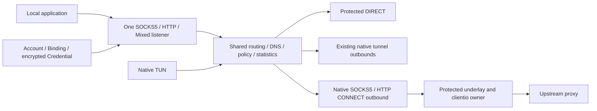

# Native SOCKS5, HTTP and Mixed proxy interfaces

Phase 20 completes the existing generic client proxy surfaces. `socks5` and
`http` upstream nodes use `EngineID=native`; `mixed` is a local listener mode.
Implementation validation does not confer platform qualification. Historical
status remains **PARTIALLY PASSED**; Phase 20 is **NOT PLATFORM QUALIFIED**;
Linux arm64 is **BUILD ONLY**.

## Boundaries

`protocol/socks5` owns RFC framing and authentication. `protocol/http` uses
`net/http` with bounded header pre-read, authority validation and nondestructive
Mixed detection. `protocol/proxy` validates node options and typed credentials.
The previous `protocol/socks` entry points delegate to the canonical codec.
Routing, DNS, policy, persistence, sockets and platform control keep their existing
owners. No independent proxy database or external core runtime is introduced.

## Capability

| Surface | TCP | UDP | Authentication |
|---|---|---|---|
| SOCKS5 inbound | CONNECT | UDP ASSOCIATE | No auth / RFC1929 username-password |
| SOCKS5 outbound | CONNECT | UDP ASSOCIATE when enabled | No auth / RFC1929 |
| HTTP inbound | CONNECT and absolute-form HTTP/1.1 forwarding | Unsupported | No auth / Basic |
| HTTP outbound | CONNECT, any successful 2xx | Unsupported | No auth / Basic |
| Mixed inbound | SOCKS5 and HTTP on one TCP listener | SOCKS5 associations only | Same account pairs for both |

HTTP upstream UDP fails with an explicit unsupported error. UDP selector choices
reject an HTTP-only selected member. URL-test, fallback and load-balance filter
incompatible members before choosing UDP; statically impossible UDP-only routes
and UDP DNS detours fail validation. DIRECT remains UDP capable.

## Listener defaults and authentication

The default listen host is `127.0.0.1`. An explicit `::1` is supported. Numeric
nonloopback addresses, including wildcard addresses, require `allow_lan=true`.
Doctor reports public unauthenticated listeners. There is no implicit LAN exposure.
SOCKS username-password and HTTP Basic are **cleartext authentication on plaintext
transport**, suitable for localhost, a trusted LAN or an independently protected
transport context. They provide no encryption.

`LocalInbound` adds `auth`, `allow_lan` and generic `bindings`. A binding references
an existing Account and an encrypted account-owned `username_password` Credential
by immutable IDs. Authenticated listeners with no eligible binding reject every
client. Binding/account enabled state, account active status, expiry and credential
state are checked. Bounded immutable snapshots use hashed constant-time comparisons.
Each listener has at most 128 bindings with unique account, binding and username
identities. TUN does not accept these proxy-specific fields.

Local binding placement uses the existing local-listener JSON because the original
SQL binding foreign key targets managed server inbounds. Schema remains 8; there is
**no new migration**. Commit and committed-state reads verify account/credential
references. Rotation creates a new credential ID and restarts active sessions after
commit; obsolete exclusive local credentials are removed without deleting accounts
or credentials used by server bindings. Existing generic account mutations retain
their established live-runtime restrictions. See [Proposed ADR 0041](../adr/0041-generic-proxy-interfaces-and-credentials.md).

## Management

All mutations use the shared Application Service validation, plan, prepare and
transaction pipeline. APIs `/api/v1/local-inbounds`, `/api/v1/nodes` and
`/api/v1/outbounds` keep their generic CRUD behavior. New routes:

| Route | Methods | Meaning |
|---|---|---|
| `/api/v1/local-bindings` | GET, POST | List / create |
| `/api/v1/local-bindings/{id}` | GET, PUT, DELETE | Get / enable-disable / delete |
| `/api/v1/local-bindings/{id}/credential` | POST | Rotate write-only credential |

Writes require the shared committed revision in `If-Match`. CLI `local-binding
list/get/validate/plan/apply` uses the same service as API; existing `local-inbound`,
`node`, `outbound`, provider and explicit node-export commands retain their roles.
Create/update/rotate/delete are mutation documents, not separate CLI implementations.
For example, a local-binding create document has `resource="local-binding"`,
`action="create"`, a `binding` containing AccountID/InboundID/enabled, and a
write-only credential input whose `kind` is `username_password` and whose `value`
is a JSON string containing the pair. IDs and UTC stamps are assigned by the service.
Changing a live listener protocol on the same occupied port can fail preparation;
stop first or use another port. Failed preparation preserves the committed runtime.

Runtime capabilities expose all three ingress modes and both upstream factories.
Shared status reports inbound, outbound, node, session and account dimensions,
payload/message byte counters, UDP packets/associations and `errors_total`.
Dimensions are projections and must not be summed. Support projections omit pairs,
raw proxy URIs and proxy authorization; explicit secret export is an intentional
separate disclosure operation.

## SOCKS5 ownership

Method negotiation offers no-auth or RFC1929 according to the listener configuration.
Authenticated clients offer only method 2. Unsupported methods return FF; BIND
returns command unsupported. IPv4, IPv6 and domain ATYP use canonical address
framing; username/password fields are each 1–255 octets. Positive short stream
writes complete; a terminal partial handshake error ends the connection.

The TCP control connection owns a local UDP socket, at most 32 destination flows,
joined workers and the retained routing generation. A client must match the TCP
peer IP and requested UDP port. Wildcard/zero requests pin the first valid UDP
source port; invalid frames cannot claim the port. Nonzero FRAG is dropped without
reassembly. The complete framed packet is bounded to 65507 bytes. The existing
canonical 2-minute idle timeout refreshes on valid sends and replies.

Dead flow readers mark their owners terminal before closing. Retirement deletes
only the same owner; delayed retirement cannot delete a replacement. Read/write
failures do not reuse dead sockets. Shutdown closes sockets and joins workers;
retirement publication also selects on cancellation.

Native SOCKS UDP outbound owns both protected TCP control and protected UDP relay
sockets under `clientio.Owner`. Explicit BND.ADDR is respected even when different
from the TCP endpoint. An unspecified BND address uses the connected TCP peer's IP;
zero relay ports reject. Control EOF closes UDP and unregisters the association.
A fresh open creates a fresh association. Concurrent Close is idempotent and joins
the control watcher; deadlines apply to active UDP IO.

## HTTP behavior

CONNECT requires a strict `host:port` authority, including bracketed IPv6, and
rejects conflicting Host, duplicate critical fields and request body framing.
Successful inbound CONNECT returns 200 and relays buffered tunnel bytes without
adding proxy credentials to application data. Upstream response parsing accepts
all 2xx, bounds up to 8 informational responses and retains coalesced server bytes;
successful CONNECT ignores advertised HTTP body length/transfer framing.

Plain forwarding accepts absolute `http://` URLs, uses shared route selection,
converts to origin form through `net/http.Transport` and streams both bodies.
There is one request per connection with `Connection: close`; persistent proxy
keep-alive/pipelining is deliberately unsupported. Headers are bounded to 64 KiB,
8 KiB per line and 129 lines. CRLF is required. CL+TE and duplicate Host,
Proxy-Authorization, Content-Length or Transfer-Encoding are rejected.
Request bodies are streamed without an unbounded allocation.

Proxy-Authorization, Proxy-Connection and hop fields nominated by Connection are
removed before origin forwarding. Standard hop fields are stripped in both
directions, including trailer declarations and late trailer values. The outgoing
request owns its Header and allowed Trailer maps; a streaming body wrapper copies
only declared end-to-end values before returning EOF. Client proxy credentials
terminate at the HTTP inbound and never propagate to origin headers or trailers.
Upstream HTTP CONNECT credentials are independently scoped to upstream proxy
authentication. Safe request and response trailers remain supported. Missing/bad
required Basic auth receives 407
and a Basic Proxy-Authenticate challenge. Raw credentials never enter diagnostic
errors. After request-body completion, an owned reader cancels the transport on
client disconnect; Close and parent shutdown join this worker and cancel a stalled
response. CONNECT retains shared relay half-close behavior.

## Mixed detection

A bounded buffered Peek selects first byte 05 as SOCKS5 or a valid HTTP method
token followed by space as HTTP. At most 33 bytes are inspected under the shared
5-second handshake deadline. Unknown bytes reject; pre-read bytes are preserved.
One TCP listener serves both protocols. UDP is available through SOCKS5 negotiation.
Partial detection disconnect and parent shutdown release the session and reader.

## DNS and import/export

An inbound domain and HTTP authority enter the shared DNS/routing system. When
managed DNS/policy requires resolution it uses the configured resolver/detour.
Otherwise the domain remains unchanged for SOCKS DOMAIN or HTTP CONNECT remote
resolution. The native SOCKS adapter does not resolve destination domains locally.
Upstream proxy endpoints or explicit domain relay endpoints may legitimately need
protected bootstrap resolution; DIRECT also resolves its own target.

Imports accept `socks://`, `socks5://`, `socks5h://` and `http://`, with optional
complete userinfo and a fragment label. They define proxy nodes; they do not add a
per-URI local DNS override. **curl** distinguishes socks5 local DNS from socks5h
proxy DNS. Splicore exports SOCKS URIs as **socks5h** to make preserved-domain
semantics explicit; shared DNS policy still takes precedence. Path/query, partial
userinfo and HTTPS upstream transport reject. Generic canonical/provider import
and explicit URI/Mihomo/sing-box exports support both protocols.

Authenticated nodes require a typed username-password credential and explicit
`auth=true`. No-auth nodes use `auth=false` and the exact nonsecret marker
`no_authentication` in the existing encrypted Password credential slot, because
the generic node model requires a credential reference. The marker is never sent
on the wire. Unexpected credential kinds or ignored secrets reject. Protocol
options describe only auth and SOCKS UDP; transport is TCP and security is none.

## Unsupported / deferred

- SOCKS BIND: unsupported / deferred; UDP FRAG != 0: unsupported and dropped.
- HTTP UDP: unsupported; HTTP/2, HTTP/3, MASQUE and CONNECT-UDP: deferred.
- Digest, NTLM and Negotiate authentication: deferred.
- MITM, TLS interception and caching: out of scope.
- HTTPS upstream proxy: deferred in this phase.
- System Proxy / PAC: Phase 21; no Phase 20 implementation changes.
- WebSocket / gRPC / XHTTP: not Phase 20.

## Standards and evidence

- [RFC 1928](https://www.rfc-editor.org/rfc/rfc1928): SOCKS5.
- [RFC 1929](https://www.rfc-editor.org/rfc/rfc1929): username/password.
- [RFC 9110](https://www.rfc-editor.org/rfc/rfc9110): CONNECT and HTTP semantics.
- [RFC 9112](https://www.rfc-editor.org/rfc/rfc9112): HTTP/1.1 framing.
- [curl manual](https://curl.se/docs/manpage.html): SOCKS DNS conventions.
- [Phase 20 implementation report](../reports/PHASE20_PROXY_INTERFACES_IMPLEMENTATION_REPORT.md).
- Raw evidence: `D:/splicore-validation/phase20-proxy-interfaces-20261008/`.

## Reviewed Phase20 Freeze identity

Targeted Independent Re-Review: PASSED — READY TO FREEZE. P20R-001 CLOSED;
new BLOCKER/MAJOR0. Implementation is REVIEWED. Freeze identity is the commit
containing `docs/reports/PHASE20_PROXY_INTERFACES_FREEZE_REPORT.md`, contingent on
the exact candidate tree, sole-parent commit and postcommit verification receipt
at `D:/splicore-validation/phase20-proxy-interfaces-freeze-20261008/`.

This is the complete native SOCKS5/HTTP/Mixed feature set, including the reviewed
HTTP credential boundary fix. One request per client TCP connection /
Connection: close remains the HTTP contract. Historical qualification remains
PARTIALLY PASSED; frozen Phase20 is NOT PLATFORM QUALIFIED, arm64 BUILD ONLY.
ADR0041 remains Proposed; Freeze records the reviewed implementation without
changing its architectural decision status.
