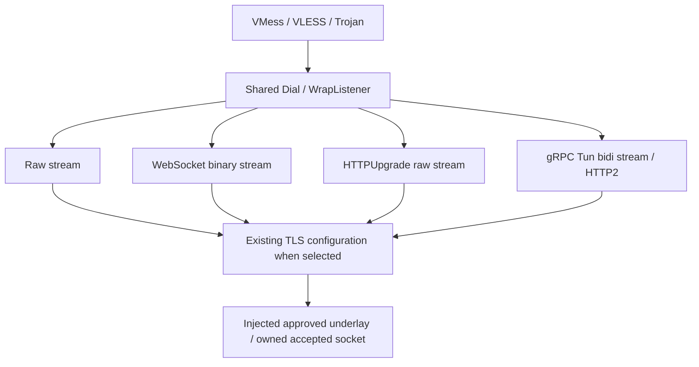

# Core Shared Stream Transport

- Documentation status: Experimental; Phase 21 Review Fix Round 1 awaiting re-review
- Audience: Core maintainers and runtime reviewers
- Last reviewed: 2026-10-08
- Owner: Splicore Core maintainers
- Responsibility: Reusable stream transport, composition, ownership and validation
- Lifecycle: Review with changes to transport intent, admission or adapters

## Product and package boundary

Splicore is a proxy core: protocol runtimes, transport, TLS, TUN, routing, DNS,
policy, nodes/providers, API/CLI and necessary Core socket adapters belong here.
Desktop system proxy settings, PAC ownership, tray/GUI and desktop startup UX
belong to upper layer clients unless explicitly authorized. Frozen TUN OS adapters
remain. The abandoned uncommitted platform direction is archived externally.

`internal/splicore/domain/streamtransport` owns bounded intent.
`internal/splicore/streamtransport` supplies `Dial` and `WrapListener`, exposing
`net.Conn`/`net.Listener`. The existing `internal/splicore/transport` owns control
API clients. Protocol authentication, encryption and TCP/UDP framing remain
protocol owned. Outbound factories validate and clone transport intent.



## Capability matrix

| Protocol | Raw | WS | HTTPUpgrade | gRPC normal Tun |
| --- | --- | --- | --- | --- |
| VMess AEAD | Existing plain / TLS | Plain / TLS | Plain / TLS | Plain / TLS |
| VLESS no flow | Existing plain / TLS / REALITY | Plain / TLS | Plain / TLS | Plain / TLS |
| Trojan standard | Existing TLS | TLS | TLS | TLS |
| SS / SS2022 / Snell / HY2 / TUIC / Mieru | Existing runtime | Rejected | Rejected | Rejected |

New REALITY combinations and Vision are rejected. Raw VLESS REALITY is unchanged.
Frozen VLESS XUDP payload behavior remains; Phase 21 adds no Mux.Cool, TunMulti or
XUDP extension. A client gRPC stream owns one HTTP/2 connection. Each server
listener belongs to one protocol/transport; automatic port demux is not provided.

## Config and exact admission

Remote node and client profile transport:

```json
{"kind":"ws","path":"/core","host":"core.synthetic.test","headers":{"X-Client":"owned"}}
```

```json
{"kind":"grpc","service_name":"CoreService","host":"core.synthetic.test"}
```

Server protocol settings use optional `stream_transport` with the same model.
Absence preserves raw TCP/TLS. Explicit null, duplicate members, folded aliases,
empty/missing discriminators and unsupported members fail closed. Server custom
headers are rejected because headers configure client requests. HTTP path defaults
to `/`; service defaults to `GunService`. Only exact normal `/<service>/Tun` is
registered. Unknown path/service/authority is rejected before protocol processing.

Unknown bounded transport discriminators remain representable during decoding so
canonical import can retain the typed `unsupported_transport` issue. Capability
validation rejects them before compilation; they never select raw TCP.

Paths have no query/fragment or whitespace; early data is deferred. Service names
are bounded ASCII letters, digits, dot, underscore and hyphen. Advanced service
paths are rejected. Configured Host / gRPC authority match case insensitively.
They are distinct from TLS SNI, physical dial target and proxied destination.
Mandatory upgrade/framing/WebSocket/gRPC and credential-bearing headers cannot
be overridden; header names are case-insensitively unique. Transport formatting
is redacted; support bundle node projections contain no header values, path or
authority. Protocol credentials stay in the existing encrypted credential model.

## TLS, routing, DNS and underlay

The caller supplies existing `tlsconfig` material. TLS is composed once over the
injected socket. HTTP transports use `http/1.1`; gRPC uses `h2`. Explicit
incompatible ALPN is rejected. Raw TCP keeps existing ALPN and protocol TLS/REALITY.

Every outbound socket uses the required injected `DialFunc`. Gorilla has plain
and TLS dial hooks and ambient proxy lookup disabled. grpc-go uses a context
dialer. Wrappers take already owned listener sockets. No production `net.Dial`,
ambient resolver or transport health worker is added.

Routing/policy select the logical outbound and application destination before
underlay dialing. Host/SNI do not become application or DNS bootstrap destinations.
Existing provider fetch and upstream chaining retain their protected socket path.
Server accept and outbound close inherit native admission and generation owners.

## WebSocket

Independent Gorilla WebSocket v1.5.3 implements RFC 6455 upgrade validation,
masking direction, continuations and control frames. Splicore accepts binary
messages, removes frame boundaries and chunks writes. Text/protocol errors are
terminal. Ping receives standard pong while reading; normal peer close becomes
EOF. Local Close interrupts the socket without requiring peer acknowledgement.

Socket wrappers preserve live user write deadlines across library frame flushes.
Read/write gates observe deadlines while waiting. Handshake cancellation owns the
socket during admission; published streams outlive the dial context and belong to
their explicit runtime owner. This is a proxy stream, without browser app routing.

## HTTPUpgrade

`net/http` serializes/parses GET/HTTP1.1. Canonical headers are `Connection:
Upgrade`, `Upgrade: websocket`, and status 101, followed by raw bidirectional
bytes. No WebSocket frames follow. Both ends preserve buffered post-header bytes
exactly once. Bodies, transfer encoding, wrong path/Host and malformed response
headers/status fail closed. TCP/TLS half-close is forwarded where available.

Review Fix Round 1 requires an HTTP/1.1 101 response with canonical upgrade
headers, no Transfer-Encoding and no nonzero Content-Length. An explicit valid
Content-Length of zero remains accepted for compatibility with the previous
contract. `net/http` remains the parser and rejects conflicting or malformed
lengths. Its 1xx ContentLength normalization is insufficient: Splicore also checks
the retained raw Content-Length header before switching to raw bytes. Buffered
post-header payload is preserved exactly once. This corrects MINOR P21R-002;
status is FIXED — PENDING RE-REVIEW. Server request framing checks are unchanged.

Phase 20 HTTP forward proxy/CONNECT remains separate. Its inbound handles one
request per client connection with `Connection: close`. P20R-001 proxy credential
trailer filtering remains unchanged.

## gRPC and stream ownership

### Connection identity (Review Fix Round 1)

Dial Endpoint, TLS ServerName / SNI and gRPC Authority are independent semantic
dimensions. The injected underlay receives the original endpoint. Shared TLS
controls certificate verification and ClientHello SNI; transport `host` controls
HTTP/2 `:authority`. Explicit values are never merged or used to resolve another
dimension. A small grpc-go credentials adapter supplies the explicit shared TLS
name to the standard TLS handshake without advertising it as channel authority.
TLS trust validation and ALPN remain owned by standard shared TLS credentials.

When authority is absent, it defaults to explicit TLS ServerName, otherwise to
the endpoint. At the lower-level Dial API, absent TLS ServerName uses grpc-go's
authority-derived verification name (without a port). Managed TLS profiles still
require an explicit ServerName; this fix does not broaden their validation.
Thus absent lower-level SNI plus absent authority derives TLS identity from the
endpoint hostname. Wrong certificate names and untrusted CAs remain failures.

These rules correct P21R-001, classified MAJOR by the independent Review.
Fix status: FIXED — PENDING RE-REVIEW; independent closure remains outstanding.

grpc-go v1.80.0 owns actual HTTP/2, ALPN, gRPC envelopes, flow control, cancellation
and status. Splicore independently encodes the researched Hunk contract: bytes
field 1, normal `/<service>/Tun`. Existing protobuf `protowire` provides primitives.
No upstream implementation or generated upstream source is copied.

One receive and one send worker adapt the bidi stream. Cross-goroutine buffers
are copied and owned; queues are bounded. Empty messages are skipped; receive
errors remain terminal across reads. Write success counts completed chunks.
Timeout/failed partial framed writes terminate the stream because commitment is
uncertain. Caller buffer reuse cannot alter worker-owned bytes.

Client Close cancels the owned connection and joins workers. Server Close cancels
the stream so the handler can return and grpc-go can release blocked Recv. Server
handlers do not wait on Recv before returning. Listener Close cancels admission,
closes sockets and pending streams, stops its server, then joins serve loops,
handlers, registries and stream workers. Siblings have independent lifetime.

## Bounds and lifecycle

| Resource | Bound |
| --- | --- |
| HTTP/gRPC headers | 16 KiB configured budget; bounded net/http admission parsing |
| Path / Host / service | 2048 / 255 / 128 bytes |
| Custom headers | 32 entries, 8 KiB aggregate |
| WS received message | 1 MiB |
| gRPC message | 1 MiB plus 16 bytes framing allowance |
| Outbound chunk | 32 KiB |
| Admission timeout | 5 seconds |
| Accepted sockets / pending streams | 512 / 64 per listener |
| gRPC concurrent streams | 128 per connection |

Close wakes blocked I/O. Live deadlines also affect serialization waits. Parent
shutdown wakes children and joins workers. Large streams do not require an
application-sized allocation in the adapter. Lifecycle x25 records
FD/goroutine/listener/stream/worker Start/Peak/End for each transport. The isolated
TUN matrix and ten-minute mixed stress validate routing, DNS and native composition.

## Node/provider and share semantics

Transport survives node persistence, provider preview/apply/failed-generation
rollback, display rename, stable IDs and SQLite backup/restore. Supported URI
fields are WS/HTTPUpgrade `type/path/host`, gRPC `type/serviceName`, and VMess JSON
`net/path/host`. URI export rejects custom headers and unrepresentable gRPC Host.
Sing-box/Mihomo projections preserve supported fields; unsupported security or
format projections remain errors, including historical version gates.

VLESS Mihomo TLS booleans are explicit: false cannot erase TLS metadata; true
cannot become plain; conflicting SNI aliases fail. Transport normalization follows
duplicate/alias checks and preserves P19R-001/P19R-003 typed errors.

## Deferred and qualification

WebSocket early data, HTTPUpgrade fast-open, XHTTP/SplitHTTP, generic QUIC, HTTP3,
mKCP/KCP, Mux.Cool, TunMulti, advanced gRPC paths, new XUDP and REALITY composition
are deferred and rejected. Historical Snell/platform limitations remain.
Historical platform qualification: PARTIALLY PASSED. Phase 21: NOT PLATFORM
QUALIFIED. Linux arm64: BUILD ONLY.

## References and evidence

- [RFC 6455](https://www.rfc-editor.org/rfc/rfc6455)
- [gRPC HTTP2 protocol](https://github.com/grpc/grpc/blob/master/doc/PROTOCOL-HTTP2.md)
- Xray [WS](https://xtls.github.io/en/config/transports/websocket.html),
  [HTTPUpgrade](https://xtls.github.io/en/config/transports/httpupgrade.html),
  [gRPC](https://xtls.github.io/en/config/transports/grpc.html)
- [sing-box transport](https://sing-box.sagernet.org/configuration/shared/v2ray-transport/)
- [Mihomo transport](https://wiki.metacubex.one/en/config/proxies/transport/)

Research and raw checks live at
`D:/splicore-validation/phase21-shared-transport-20261008/`. Implementation checks
precede independent Review and Freeze; neither is executed in this phase.
