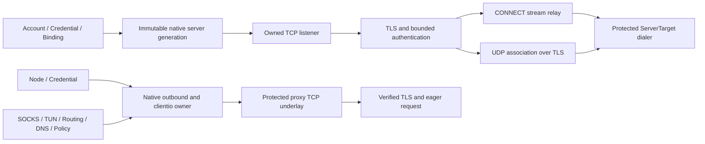

# Native standard Trojan

Phase 18 adds `ProtocolID=trojan`, `EngineID=native`, wire version `standard`,
feature profile `base` to the independent Splicore core. It uses Go TLS and
crypto, shared domain/storage/routing services, and Splicore owned framing.
No reference implementation source or production proxy subprocess is used.

## Ownership

`internal/splicore/protocol/trojan` owns configuration, creation, credential
validation, profiles and URI conventions. `protocol/trojan/wire` owns bounded
application framing. `protocol/trojan/backend` owns stream/packet adapters.
The native compiler and outbound factory own TLS sockets and workers.

## TLS and authentication

TLS is mandatory: minimum TLS 1.2, system trust or the existing single explicit
CA, certificate name verification enabled. Connect address and SNI are distinct.
There is no insecure verification option in the shared model. ALPN is optional;
no HTTP ALPN is forced. Static certificate/key files are validated and snapshotted
before activation, including chain, name and leaf checks. Certificate replacement
requires the existing controlled generation replacement; no file watcher or ACME
subsystem is added. TLS/authentication has the existing five second request budget.

Authentication is 56 lowercase ASCII hex bytes of SHA-224(password), followed by
CRLF. Derivation uses `crypto/sha256.Sum224`. Passwords use the existing encrypted
vault and the managed password policy (12–255 UTF-8 bytes, no spaces or controls).
Runtime generations retain only derived credentials. The digest is secret
equivalent; formatters redact it. Matching scans every fixed-size user credential
with `crypto/subtle`, with no early user match return. This is not a claim of
perfect network side-channel resistance. Identical derived identities are rejected.

## TCP and UDP

Requests contain command 1 (CONNECT) or 3 (UDP ASSOCIATE), a SOCKS address/port,
and CRLF. One TLS stream belongs to one TCP connection or UDP association.
Requests are sent eagerly, allowing server-first TCP applications. The decoder
consumes exactly the header; arbitrary fragmentation and coalesced payload work.
Shared relay workers preserve useful TLS/TCP write-half closure and are joined
on shutdown. Full close aborts the raw socket before closing TLS to interrupt IO.

Each UDP frame contains address/port, big-endian uint16 payload length, CRLF,
and the payload. Empty payload is valid. The wire ceiling is 65,535 bytes; actual
target UDP socket limits remain separate. No segmentation or mux extension is
invented. The server permits 512 accepted/pre-authenticated sockets, and the
shared UDP relay permits 128 target sockets per association with five second idle
expiry. The existing SOCKS and TUN admission/flow limits remain authoritative.

### UDP target lifecycle (Review Fix Round 1)

One `relay.Packets` parent owns a private `access.Endpoint` registry for each
authenticated association. User and session isolation comes from that parent
scope. A target owns its protected `ServerTarget` socket, private reply scratch,
reader, terminal state and, when idle expiry is enabled, one timer worker.
Only active owners are registered; the 128 limit counts concurrent active targets.
Replacement sockets use the same supplied protected dialer.

The existing relay `idle` argument is the timeout source. Trojan passes five
seconds, consistent with VLESS, TUIC and HY2; there is no new configurable timeout.
Target inactivity and association read inactivity are separate. A valid outbound
datagram admitted to an active socket refreshes target activity before IO to
serialize admission against expiry. Successful outbound writes and inbound remote
reads refresh it again. Activity timestamps only advance. Sibling traffic cannot
keep an inactive target alive. The target timer checks the latest activity at each
wakeup and rearms to that deadline; there is no goroutine or timer per packet.

Every target reader error remains terminal, following the existing relay policy;
Go's network poller handles EINTR/EAGAIN. No target read deadline or unbounded
temporary-error retry loop is added. Reader exit, idle expiry and explicit target
retirement mark the owner terminal and delete its registry entry only when that
key still refers to the same object. Socket Close runs once outside the registry
mutex. Old readers and timers cannot delete a newer same-key owner. The next
datagram creates a fresh socket and reader. A target socket write error or short
write retires that target and drops that datagram without replaying an uncertain
write; later datagrams may recreate it. These target-local events preserve siblings.

Parent shutdown marks closing, detaches all owners and stops their timers under
the registry mutex, then closes the framed packet and remote sockets and joins
all reader/timer workers outside the mutex. Registration is rejected after closing.
No registry lock spans dial, network IO, packet callbacks, socket Close or Wait.
Framed TLS write failures keep the existing association-terminal semantics below.

Independent review found this lifecycle absent in the initial implementation
(`T18R-001`, MAJOR; **PHASE 18 REVIEW FAILED**). Round 1 implements the contract;
final independent re-review passed with T18R-001 **CLOSED**. Validation and preserved
history are recorded in the Phase18 implementation report and the local
[Phase 18 Freeze report](../reports/PHASE18_NATIVE_TROJAN_FREEZE_REPORT.md).

Packet writes acquire shared cancellable admission, encode into fresh storage,
perform synchronous socket IO, and join cancellation callbacks. No detached
writer or unbounded datagram queue exists. Every failed admitted TLS write retires
its association, including a zero-byte failure: Go TLS memoizes write errors.
Queued cancellation does not touch the stream. Read errors retire the framed
association and preserve socket EOF/deadline errors. A short receive buffer drops
the already consumed datagram with `io.ErrShortBuffer`. Separate associations are
independent siblings; destinations inside a poisoned association share its fate.
Close is idempotent and joins admitted writes, reads and the parent callback.

The listener owns accepted raw sockets until worker completion. Closed connections
unregister using their unique connection owner. The client uses `clientio.Owner`
for pending opens and published sockets. There is no session-ID reuse registry or
Trojan-specific persistent account database.

## Management and diagnostics

Generic creation creates accounts, account-owned encrypted password credentials,
and bindings. `/api/v1/inbounds/{id}/binding` and `inbound binding --file` share
the Application Service: an ordinary request enables/disables a binding; optional
`action=rotate` supplies a write-only `credential`; `action=delete` atomically
removes an exclusively referenced binding, credential and account. Mutations
replace the inbound generation and close its active sessions, including B's active
sessions when A changes; B's committed credentials and new sessions remain valid.
Shared references reject rotation/deletion and restore the committed generation.
There is no new migration or Trojan-only API.

Nodes, Provider preview/apply/refresh, stable IDs, reference safety, encrypted
source credentials, backup/restore, stats, doctor and support use existing services.
Support projections recognize Trojan without exposing passwords, digests, raw
credential URIs or private key material. Explicit authorized export is the existing
intentional secret disclosure boundary. Routing, DNS, policy probes and target
sockets all use shared protected dialers; TLS adds no additional dial surface.

## URI and interoperable formats

`trojan://` supports percent-escaped password, IPv4/IPv6/domain endpoints,
default port 443, SNI/peer, optional comma-separated ALPN and display fragment.
Only standard TLS/TCP options are accepted. Unknown extensions, insecure flags,
duplicate query fields, malformed encodings/ports and control characters reject.
URI export rejects explicit CA trust, disabled UDP and ALPN tokens containing a
comma because those configurations cannot round trip faithfully.

Mihomo 1.19.30 and sing-box 1.14.1 exports are version pinned and preserve TLS
verification. Sing-box explicit CA exports round trip. Mihomo exports use the
existing verified CA fingerprint contract; fingerprint-only imports reject because
the shared CA model cannot reconstruct a trust anchor from its digest.

Compatibility decisions:

- T18-COMPAT-001: Mihomo 1.19.30 splits/rejects payloads above 8,192 bytes.
  Its interop matrix covers whole datagrams up to 8,192; Splicore retains canonical
  frame/datagram boundaries up to the wire ceiling.
- T18-COMPAT-002: strict CRLF; unsupported commands including mux `0x7f` reject.
- T18-COMPAT-003: Mihomo 1.19.30's Trojan UDP reader rejects domain addresses
  (`Addr.UDPAddr` only converts IPv4/IPv6). Its server matrix uses numeric UDP;
  domain UDP is covered against sing-box and Splicore. No implicit resolver bypass
  is introduced to conceal this peer limitation.

## Trojan fallback decision: DEFERRED

The [canonical specification](https://trojan-gfw.github.io/trojan/protocol.html)
describes fallback for non-Trojan requests. The
[sing-box inbound](https://sing-box.sagernet.org/configuration/inbound/trojan/)
provides optional fallback. Phase 18 explicitly permits deferral and excludes
camouflage/HTTP server feature work. Invalid TLS/auth/request connections close
generically. Fallback is not misclassified as absent from the canonical spec.

Version research and exact source hashes are external in
`D:/splicore-validation/phase18-native-trojan-20261007/spec/`. Peer source is for
behavior research only. See the implementation report for actual gates and limits.
Platform qualification remains historical PARTIALLY PASSED; this implementation
is NOT PLATFORM QUALIFIED. The reviewed implementation is locally frozen after
exact-index verification of eleven CRLF/LF-only files. The first Freeze block is
preserved in the canonical Freeze report. One forward local commit records Phase 18;
publication, release and platform requalification were not performed.
