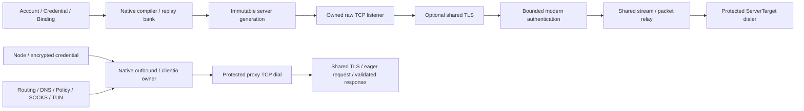

# Native modern VMess runtime

Phase 19 implements `ProtocolID=vmess`, `EngineID=native` in the independent
Splicore core. Implementation validation does not confer platform qualification.
Historical qualification remains **PARTIALLY PASSED**; Phase 19 is **NOT PLATFORM
QUALIFIED**; Linux arm64 is **BUILD ONLY**.

## Compatibility boundary

Modern AEAD and `alterId=0` are supported over raw TCP and the shared verified
TLS wrapper. TCP and standard command-2 UDP support IPv4, IPv6 and domain targets.
Payload modes are `auto`, `aes-128-gcm`, `chacha20-poly1305` and `none`. Auto sends
AES-GCM on amd64/arm64/s390x and ChaCha elsewhere; it never emits an auto wire ID.
None still authenticates the modern AEAD header. None/TCP supports the unframed
body used by current clients and framed peer requests; UDP always uses chunks.

Legacy alterId>0 and legacy non-AEAD headers are **DEFERRED / UNSUPPORTED**.
`zero`, legacy CFB, connection reuse, authenticated-length and unknown option bits
are rejected. Authenticated-length is optional in the selected peers and their
current bidirectional context reuse conflicts with the no-nonce-reuse requirement.
Splicore does not substitute a different wire construction.

WS, gRPC, HTTPUpgrade, XHTTP, h2, mKCP, VMess QUIC, Mux, XUDP, packetaddr, uTLS,
REALITY and camouflage are outside this phase. Xray interop selects standard UDP
with `XRAY_CONE_DISABLED=true`; its default cone/Mux conversion is outside this
baseline. No external core, supervisor or production subprocess is present.

## Ownership and package boundaries

`protocol/vmess/wire` owns AuthID, KDF, request/response models, replay tokens and
chunk state. `protocol/vmess/backend` owns serialized stream and fixed-destination
packet adapters. `internal/splicore/protocol/vmess` owns managed validation,
creation, credentials, profiles and URI conventions. Native compiler/outbound
adapters own sockets and shared relays. Routing, DNS, TLS, policies, SQLite and
accounts remain in their existing core boundaries.

## Authentication, clock and replay

UUID identity is any valid dashed hexadecimal 16-byte UUID; validation does not
restrict the UUID version. Encrypted generic UUID credentials remain separate
from Account/Credential IDs. Runtime user snapshots keep command-key material and
an AES decoder; replay entries contain only fixed opaque digests. Keys and request
models have redacted formatters. Ordinary APIs, errors and support output omit
UUIDs and derived/session keys. Controlled explicit exports reveal credentials.

Protocol-required MD5 command-key/ChaCha expansion uses the Go primitives; the
nested KDF uses HMAC-SHA256. AuthID is AES-encrypted Unix seconds, random bytes and
CRC32. Candidate selection scans all configured users, with at most 16 users.
Unknown user, clock error, replay and malformed authentication close remotely.
This bounded implementation does not claim constant network timing.

The native server reads all 16 AuthID bytes before sampling the compiler's
injected clock, immediately before integrity/timestamp validation. A fragmented
AuthID that expires while being read rejects before any target dial or payload.
The later AEAD request header uses the completed AuthID decision; a header delay
does not independently resample its timestamp. Atomic replay admission still
checks the compiler bank's high-water mark. The fixed-time `ReadRequest` helper
is for explicit-time callers; native network authentication uses
`ReadRequestWithClock`.

Skew is inclusive
±120 Unix seconds; negatives, signed conversion overflow and expiry overflow
reject. Pre-authentication has a five-second deadline and a 512-socket admission
cap. No legacy fallback is attempted after AEAD failure.

The compiler owns a replay bank across runtime generation replacement. Each
accepted request atomically reserves three opaque SHA256 tokens: keyed AuthID,
request data key/nonce context and response data key/nonce context. Capacity is
65,536 tokens, at most 21,845 contemporary requests when each consumes three.
Entries expire strictly after timestamp+120 seconds (up to 240 seconds after
earliest acceptance). Full capacity fails closed and never evicts a valid-window
token. Lazy heap cleanup uses no worker, timer or FD. A wall-clock high-water mark
prevents rollback resurrecting retired authentication. Entries intentionally
remain across listener Close until expiry/admission/snapshot cleanup; zero session
counts do not imply zero live-window replay entries. Process restart is not
persistent replay protection. Random session material plus bounded reuse checks
is not a proof of never repeating a nonce across arbitrary process lifetimes.

## Header and payload

ReadFull handles fragmented AuthID, encrypted length, nonce, header and tags.
Header-length authentication precedes allocation; supported decoded headers are
47–316 bytes. Version, reserved byte, checksum, options, command and addresses
validate before routing. TCP command is 1; UDP command is 2. Response length and
authentication marker validate before any payload becomes visible. Response
options may be zero (Xray) or the exact request options (current sing-vmess);
other declarations and response commands reject without enabling stream reuse.

Encrypted chunk nonces are uint16 big-endian counter plus IV[2:12]. Each direction
has its own SHA256-derived response or request key/IV, mask and counter. Counter
65535 is usable once; the next operation is terminal. Chunk wire bodies are at
most 16,384 bytes. SHAKE128 masking advances independently by direction; global
padding consumes its length before the mask and fills content with crypto/rand.
Randomness failure propagates. Padding with none or without masking rejects.

## TCP, UDP and shutdown

Requests are eager; response validation is lazy because peers may wait for first
payload. TCP preserves fragmentation/coalescing and server-first traffic. Upload
EOF uses the shared relay's half-close and permits target response traffic for
raw and TLS, including unframed none. A failed admitted write, partial frame,
invalid response or data framing/authentication error retires the stream.
Positive short writes are completed synchronously; no detached tail writer runs.
Close interrupts raw IO before joining directional locks and cancellation
callbacks, including TLS writes that hold the TLS write lock.

One standard UDP stream binds one request destination. Each datagram is one
chunk; no per-packet address extension, splitting or coalescing is invented.
Empty datagrams reject because empty chunks are EOF. Oversized datagrams reject.
Replies report the bound destination. A server-bound domain stream can map its
resolved numeric target's same-port reply metadata back to the bound domain;
outbound writes still require the exact destination.

The existing client flow registry owns destination associations. The shared
target relay owns numeric sockets, 128-target bound, reader retirement,
five-second idle expiry and identity-safe replacement. Reader death makes the
association terminal or retires its target; next traffic obtains a valid owner
or fails clearly. Packet writes use shared bounded queue admission and live
deadlines; Packet Close waits for admitted operations and their cancellation
callbacks. Parent Close joins its workers. No parallel VMess registry is added.

## Managed services and exports

Native registration uses existing Account/Binding/Credential, Node/Provider,
Application Service, `/api/v1`, CLI, backup/restore and SQLite schema 8. No new
migration or secret database is added. Rotation follows generic generation
semantics; held sessions and unrelated users are covered by management tests.
Inbound `payload_security` is the default for exported clients. Each authenticated
request selects a supported wire payload mode; the setting does not limit the
server to one cipher.
Shared traffic counters attribute account/binding/node TCP/UDP payload activity.
Doctor/support output uses redacted protocol and resolved security metadata.

`vmess://` is bounded base64 JSON management serialization, not the wire spec.
Only faithful TCP, alterId0, supported security and verified TLS fields import.
Duplicate/conflicting/null/unknown fields, invalid UTF-8, control characters,
UUID/port errors and unsupported transports/extensions report issues. Input is
at most 4096 encoded / 3072 decoded bytes. Supported exports round-trip semantics.
Nested external TLS fields require exact names and unambiguous scalar values;
case-folded aliases cannot override verification intent.

Managed VMess settings/options, creation users and managed TLS preserve raw
member presence before struct decoding. One historical case variant remains
accepted. Different case spellings together are accepted only for equal JSON
values (objects compare without member order, numbers retain exact precision);
different values return `Invalid/conflicting_field` before defaults or legacy
validation. Equal nonzero alterId aliases still return
`Unsupported/unsupported_legacy_vmess`. No enum case conversion or credential
rewrite is added. Every exact duplicate key rejects, including equal values.
Individual VMess objects are bounded to 16 KiB and 64 supplied members; URI
bounds stay smaller and the creation envelope retains 64 KiB/16 users.
URI and external format whitelists remain exact, with no new aliases.
Mihomo `sni` and `servername` are existing alternatives: supplying both rejects
as `conflicting_field`, including equal/empty values.

Import issues retain `unsupported_legacy_vmess`, `unsupported_transport`,
`unsupported_security`, `invalid_credential` and `conflicting_field` through URI,
base64, external config and applicable canonical/provider paths. Unsupported
classes use `Kind=Unsupported`; credential/conflict classes use `Kind=Invalid`.
`ManagementDiffEntry.change` carries these fixed safe codes; no raw UUID or link
is exposed. Typed causes unwrap to existing domain errors and are translated
without parsing human messages. Strict rejected previews issue no apply token;
lenient apply uses only the valid candidates in the saved plan and retains the
per-item issues. Provider rejection preserves committed nodes and generation,
while existing failure-status accounting still applies.
URI and Mihomo cannot carry this model's explicit CA without loss and reject it;
sing-box preserves that CA. Pinned exporter versions are sing-box 1.14.2 and
Mihomo 1.19.32. URI cannot faithfully encode UDP-disabled profiles and rejects them.

## Evidence and provenance

See the [Phase 19 implementation report](../reports/PHASE19_NATIVE_VMESS_IMPLEMENTATION_REPORT.md)
and [Proposed ADR 0040](../adr/0040-modern-vmess-and-replay-clock-ownership.md).
External evidence is `D:/splicore-validation/phase19-native-vmess-20261007/`.
Published VMess documentation and pinned mature implementations were studied;
the production framing is Splicore-owned. Independent synthetic vectors were
generated using Xray v26.3.27 in an external oracle module, with source hashes and
licenses retained. Reference packages/binaries are absent from production graph.

## Final review and Freeze identity metadata (2026-10-08)

Implementation status: **PHASE 19 IMPLEMENTATION REVIEWED**. Final Independent
Re-Review PASSED; P19R-001/002/003 and P19RR-001 CLOSED, new BLOCKER/MAJOR=0.
P19RR-001 is a harness/Mihomo startup-readiness artifact; production fix NONE.
The Match-rule management response alone was insufficient; the corrected test
harness waits for the same-configuration completion barrier. No production
startup sleep, retry, peer special case or VMess runtime change was added.

[Canonical Freeze report](../reports/PHASE19_NATIVE_VMESS_FREEZE_REPORT.md)
identifies the single commit containing it. The external final receipt in
`D:/splicore-validation/phase19-native-vmess-freeze-20261008/` resolves commit
success and final Git/tree/gate status. This preparation metadata does not claim
commit success. ADR0040 remains Proposed. Historical qualification remains
PARTIALLY PASSED; Phase19 NOT REQUALIFIED / NOT PLATFORM QUALIFIED;
Linux arm64 BUILD ONLY. Runtime/protocol architecture above is unchanged.
