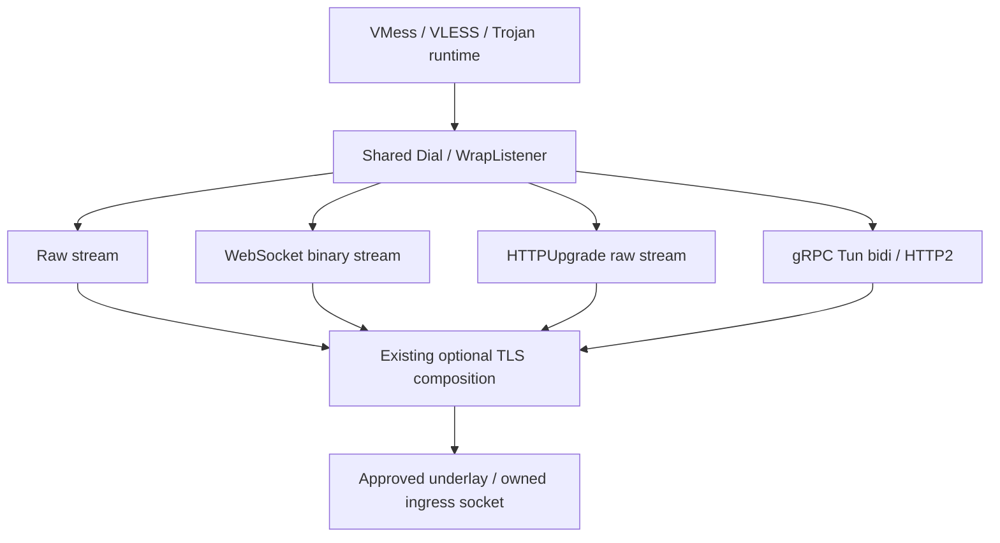

# Splicore Phase 21 Shared Transport Layer Implementation Report

## Verdict

**PHASE 21 READY FOR REVIEW**

Core shared WebSocket, HTTPUpgrade and normal gRPC Tun transports are implemented for the researched VMess/VLESS/Trojan pairs. Final default/native tests, race gates, fuzz, resource x25, isolated Native TUN, 36 external pairwise rows, three builds and the final ten-minute mixed stress passed. This is an implementation result; independent Review and Freeze have not been executed.

Evidence root: `D:/splicore-validation/phase21-shared-transport-20261008/`.
Final production verification label: **final4**. Final stress label: **final5**, after a build-tagged lab-only deadline correction; production Go bytes remain identical to final4. Raw intermediate failures, diagnostics and canceled runs remain in separate historical paths; they are not counted as final passes.

## Direction Correction

Previous uncommitted Phase21 platform-integration direction: **ABORTED — OUT OF PRODUCT SCOPE**.
Previous status: READY FOR REVIEW. Previous work: **NOT COMMITTED / NOT FROZEN**. Previous Review: NOT EXECUTED.

External archive: `D:/splicore-validation/phase21-aborted-platform-integration-20261008/`.
The archive preserves the binary patch, exact original source bytes, changed/untracked manifests, source hashes, Git prestate, classification and restoration verification. All 37 dirty files were accounted for: 23 tracked and 14 untracked; category A=30, B=7, unrelated C=0, unknown D=0. Cleanup was limited to those explicit verified files.

Phase20 frozen baseline was restored exactly before corrected Phase21 began: worktree CLEAN, Index EMPTY, diff HEAD EMPTY, tree `56c181b39cf4c435aba03d4d815b1125f03e0444`. Offline `go mod verify` and `go list ./...` passed. The current branch was renamed after restoration; no history was rewritten. An empty stale index lock was preserved in the archive with the corresponding diagnostic record.

The old platform evidence at `D:/splicore-validation/phase21-platform-integration-20261008/` remains untouched: its 192 sealed evidence files and all 194 inventory entries were verified by SHA-256. No old report was rewritten. Desktop system-proxy, PAC, WinINET, GUI and desktop ownership artifacts introduced by that direction were removed from the corrected worktree. Existing frozen TUN and necessary Core OS adapters remain.

Splicore remains an independent proxy core. Desktop configuration and user interface ownership belong to upper-layer clients unless explicitly authorized later.

## Base

| Item | Value |
| --- | --- |
| Repository | `D:/code/Splicore` |
| Frozen base / HEAD | `1ef9458a2c06aa974e721db2fe4f271bb9068ef6` |
| Sole parent | `401b9e8b6032197108548ada7a4472440dfc65fc` |
| Base message | `feat(client): add native socks5 http and mixed proxy interfaces` |
| Branch | `codex/phase-21-shared-transport` |
| Index | EMPTY |
| Working tree | DIRTY / UNSTAGED |
| Commit | NONE |

Exit state is captured with native Windows Git in `audit/git-exit.json`; `audit/final-source-manifest.json` identifies the exact tracked and untracked repository bytes. WSL Git line-ending status is not used as the authoritative dirty-state measure.

## Existing Transport Audit

The preimplementation audit is retained in `PHASE21_EXISTING_TRANSPORT_AUDIT.md` and `existing-transport-audit.json`.

| Classification | Existing surface | Decision |
| --- | --- | --- |
| A reusable | Approved underlay, shared TLS material, strict JSON/import and provider transactions | Reuse |
| B partial | `internal/splicore/transport` control/API transport | Retain its existing responsibility |
| B partial | RemoteNode/clientprofile transport intent | Consolidate into shared bounded domain intent |
| C protocol-local duplicate | Native VMess/VLESS/Trojan stream/TLS setup | Compose shared adapters around retained protocol runtimes |
| D test-only | Existing echo, peer, TLS and isolated TUN fixtures | Reuse and extend only for validation |
| E missing | Managed shared WS/HTTPUpgrade/gRPC stream runtime | Implement once in shared package |
| F abandoned/historical | Uncommitted desktop-platform Phase21 | External archive; no runtime reuse |

No unrelated directory reorganization or second control/API transport architecture was introduced.

## Architecture

`internal/splicore/domain/streamtransport` owns transport intent and capability checks. `internal/splicore/streamtransport` owns shared wire adapters. Native VMess/VLESS/Trojan accept and dial paths consume that common layer. Protocol authentication, encryption, packet framing and destination processing stay in their existing runtimes.

Each listener owns one protocol/transport endpoint. Automatic shared-port protocol demux and new application multiplexing are not implemented. No new OS desktop setting owner is introduced.

## Transport Abstraction

`Dial(ctx, approvedDialFunc, address, config, tlsConfig)` returns `net.Conn`; `WrapListener(base, config, tlsConfig)` returns `net.Listener` and takes ownership on success. Raw TCP preserves the frozen raw/TLS/REALITY runtime path. Shared adapters expose stream Read/Write/Close and mutable deadlines without exposing transport frames to protocol code.

Close interrupts blocked work; parent listener shutdown cancels admission and streams, closes pending/accepted sockets and joins serve loops, handlers, registry watchers and adapter workers. Framed writes count completed chunks and become terminal on uncertain partial commitment. Queues and messages are bounded. Cross-worker buffers are copied and explicitly owned.

## Compatibility Research

Research was completed before implementation using official Xray, sing-box and Mihomo documentation, RFC 6455 and the gRPC HTTP/2 contract. Sources and the initial research matrix are preserved in `PHASE21_TRANSPORT_COMPATIBILITY_MATRIX.md`/JSON. Its original pending-runtime rows are historical research; `interop/final-matrix.json` is the completed measured runtime matrix.

| Family | WS | HTTPUpgrade | gRPC | Runtime evidence in this phase |
| --- | --- | --- | --- | --- |
| Xray-core 26.3.27 | Client/server | Client/server | Client/server, normal Tun | 18 actual rows |
| sing-box 1.14.2 | Client/server | Client/server | Client/server, normal Tun | 18 actual rows |
| Mihomo 1.19.32 | Client settings; documented listener forms | Client `ws-opts.v2ray-http-upgrade`; HTTPUpgrade listener not claimed | Client settings; documented listener forms | Research/import/export only; zero runtime rows |

WS uses RFC 6455 binary data and canonical path/Host. HTTPUpgrade uses a 101 response followed by raw bytes. gRPC uses normal `/<service>/Tun`, bidirectional streaming and protobuf bytes field 1. WS early-data/subprotocol semantics, HTTPUpgrade fast-open, TunMulti and advanced service paths are deferred and rejected when configured.

Reference behavior and the published protobuf wire specification were read; no Xray, sing-box or Mihomo implementation source was copied. External binaries are validation peers, not Splicore runtime dependencies. Their versions and SHA-256 identities are recorded in `interop/versions.json`.

## Protocol / Transport Matrix

| Protocol | Raw | WS | HTTPUpgrade | gRPC normal Tun |
| --- | --- | --- | --- | --- |
| VMess AEAD | Existing plain/TLS | Plain/TLS | Plain/TLS | Plain/TLS |
| VLESS no flow | Existing plain/TLS/REALITY | Plain/TLS | Plain/TLS | Plain/TLS |
| Trojan standard | Existing TLS | TLS | TLS | TLS |
| SS/SS2022/Snell/HY2/TUIC/Mieru | Existing runtime | Rejected | Rejected | Rejected |

The local native matrix covers 15 new protocol/transport/security pairs: VMess six, VLESS six, Trojan three. The external 36-row matrix uses TLS for every row. Plain VMess/VLESS are verified locally, not claimed as separate external rows. Unsupported pairs fail configuration compilation without falling back to TCP.

## WebSocket

### Client

Gorilla WebSocket v1.5.3 provides the RFC implementation. Splicore supplies the approved dial hook, existing TLS config, explicit path/Host and bounded validated custom headers. Ambient proxy discovery is disabled.

### Server

The owned HTTP listener accepts the exact configured GET/HTTP1.1 path and optional Host. Unknown endpoints, bodies, transfer encoding and unimplemented subprotocol/early-data headers are rejected before protocol admission. Upgraded sockets are registered under the listener owner.

### Handshake

The independent library owns Sec-WebSocket-Key/Accept, Connection/Upgrade validation, masking direction, binary/continuation and control framing. No custom RFC parser or browser framework was added. Ping receives the library's standard pong during reads; normal close maps to EOF, while malformed/text traffic is terminal.

### Stream Semantics

Reads concatenate binary message data across frame/message boundaries. Writes split streams into 32 KiB chunks. Serialization gates observe deadlines; successful counts describe completed chunks. Partial framed failures close the stream rather than claiming full success.

### TLS

Existing certificate/trust/SNI material is composed once; ALPN is HTTP/1.1. Incompatible explicit ALPN is rejected.

### Lifecycle

Original admission context cancellation closes an unpublished socket. Published connections belong to the runtime owner. The live write-deadline wrapper prevents library frame flushes from replacing an updated user deadline. Blocked I/O, parent close, continuation/control interleaving, normal close and sibling isolation passed deterministic and race gates.

### Bounds

Received binary message limit: 1 MiB. Outbound chunk: 32 KiB. Config custom headers: 32 entries / 8 KiB. HTTP header budget: 16 KiB. Admission timeout: five seconds. Early data remains deferred.

## HTTPUpgrade

### Client

Go `net/http` serializes GET/HTTP1.1 over the approved owned socket. It sends canonical Connection/Upgrade headers, validates 101 and the required response headers, and returns the raw stream after successful upgrade.

### Server

The shared HTTP server validates exact path/optional Host and empty-body framing, sends 101 and hijacks the owned connection. No WebSocket frames follow this handshake.

### Upgrade Semantics

Malformed status, missing Upgrade, unexpected EOF, wrong path/Host and unsupported request framing fail closed. Safe standard HTTP primitives are reused; no custom request-smuggling-prone HTTP parser was introduced.

### Buffered Bytes

Both request-side and response-side buffered post-header bytes are retained exactly once. Fragmented handshake and coalesced upgrade/first-payload tests passed, including a synthetic response carrying `first` immediately after its headers.

### TLS

Existing TLS composition uses HTTP/1.1 ALPN without duplicate encryption.

### Lifecycle

Socket deadlines remain live; Close and parent shutdown wake blocked I/O and join owners. TCP/TLS half-close is forwarded where the underlying socket permits it; a half-close test verifies EOF in one direction while reverse traffic still succeeds. Header/path/Host/admission bounds are shared with WS.

## gRPC

### Dependency

grpc-go v1.80.0 provides actual gRPC and HTTP/2; it was already present in the frozen module graph and is now direct. Apache-2.0; minimum Go 1.24.0. The independently written Hunk codec uses existing protobuf `protowire` primitives.

### Client

A grpc-go context dialer invokes only the approved underlay. Each proxy stream owns its own HTTP/2 connection and bidi RPC. Host config maps to authority; it does not change the physical dial target or TLS SNI.

### Server

The shared listener registers only the configured service's normal Tun stream and validates authority when configured. Unknown service/method/authority is rejected. The server uses bounded headers/messages/concurrent streams and owned sockets.

### Service Semantics

Default service: `GunService`; method: `/<service>/Tun`. The message wire contract is bytes field 1. No fake raw stream named gRPC, TunMulti, custom upstream generated implementation or unimplemented advanced method dialect is used.

### HTTP/2

grpc-go owns the HTTP/2 connection, gRPC envelope, flow control, cancellation and status. Native HTTP/2 stream handling does not imply new Splicore mux or listener demux support.

### TLS / ALPN

TLS uses the existing shared material once with `h2`; incompatible explicit ALPN is rejected. Plain HTTP/2 gRPC is permitted for supported VMess/VLESS local profiles. Trojan remains TLS only.

### Stream Adapter

One receive and one send worker translate bidi messages into stream reads/writes. Empty messages are skipped. Terminal receive errors remain sticky. Worker-owned copies prevent caller buffer reuse races; bounded queues prevent application-sized buffering. Write success counts completed chunks; uncertain timeout/failure during framing terminates the stream.

### Lifecycle

Client Close cancels the owned connection and joins its workers. Server Close allows the handler to return before waiting for blocked Recv, letting grpc-go cancel receive work. Listener Close stops gRPC, then joins handlers, stream workers and registry watchers. Context cancellation, unavailable admission, sticky EOF, exact endpoint rejection, live deadlines, concurrent sessions and parent stop passed.

### Bounds

Chunk: 32 KiB. Received/sent message: 1 MiB plus 16 bytes framing allowance. Header list: 16 KiB. Service: 128 bytes, bounded ASCII letters/digits/dot/underscore/hyphen. Concurrent streams: 128 per connection. Accepted sockets: 512 per listener. Pending accepted streams: 64. Admission timeout: five seconds.

## TLS Composition

Protocol payload -> selected shared stream transport -> existing optional TLS -> approved socket. No second TLS stack or protocol-specific HTTP TLS implementation was created. SNI, HTTP Host/authority, physical endpoint and proxied application destination are separate values. Raw TLS/REALITY ALPN and framing remain unchanged; explicit incompatible shared-transport ALPN fails validation.

## REALITY Boundary

Frozen VLESS raw REALITY support remains. New WS/HTTPUpgrade/gRPC REALITY combinations and Vision are rejected. Phase21 makes no REALITY redesign or silent downgrade.

## Config Model

Shared config fields: `kind`, `path`, `host`, `headers`, `service_name`. Remote nodes and client profiles use the same intent; native server settings expose optional `stream_transport`. Absent server config retains raw behavior; explicit null, duplicate member, folded alias, missing/empty JSON discriminator or unsupported member is rejected. Existing programmatic default raw intent remains compatible.

Unknown bounded discriminators are retained during decoding solely to preserve canonical import's typed `unsupported_transport` issue. Capability validation rejects them before runtime compilation; no fallback occurs. Header names are case-insensitively unique and validated. Mandatory handshake/framing/gRPC headers, pseudo-headers and credential-bearing headers cannot be overridden. Inbound nonempty custom headers are rejected as client-only intent.

| Config/resource | Bound |
| --- | --- |
| Config JSON / HTTP header budget | 16 KiB |
| Path / Host / service | 2048 / 255 / 128 bytes |
| Custom headers | 32 entries / 8 KiB aggregate |
| WS message / gRPC message | 1 MiB / 1 MiB + 16 bytes |
| Write chunk | 32 KiB |
| Accepted sockets / pending streams | 512 / 64 |
| Handshake | 5 seconds |

HTTP paths default to `/` and exclude query/fragment/whitespace. Host matching is case insensitive and exact including any configured port. Config Clone copies header maps. Formatting is redacted; support-bundle node projections do not expose header values, path or authority. Protocol credentials stay in the existing credential model.

## Node / Provider

The immutable Node ID carries transport intent through persistence, preview, validation, apply, display rename, generation compilation, failed-generation rollback and backup/restore. Nine VMess/VLESS/Trojan x transport provider rows passed. Display names do not replace identity references. Final full application default/native/race gates execute the same provider regression tests.

## URI / Import / Export

Supported transport semantics are preserved in VMess JSON URI, bounded VLESS/Trojan query forms, sing-box transport objects and Mihomo WS/gRPC options, including HTTPUpgrade's `v2ray-http-upgrade` encoding. The 27 format/pair roundtrip cases pass in final suites, including native Windows.

URI export rejects custom header maps and unrepresentable gRPC Host rather than dropping them. Duplicate/root/nested aliases are checked before normalization. Mihomo VLESS TLS false cannot erase TLS metadata; true cannot become plain, requires effective SNI and rejects conflicting aliases or unsupported CA pins. Historical version/security limitations remain explicit errors. No arbitrary client dialect, early-data or unsupported transport is silently projected.

## Routing / DNS / Policy

Existing routing and policy choose the logical outbound and proxied destination. Transport Host/authority/SNI do not become application destinations or ambient DNS bootstrap targets. The isolated TUN lab verifies IPv4/IPv6 TCP and UDP, proxied TCP/UDP DNS, selector updates, protected upstream SOCKS/HTTP chains and HTTP UDP rejection with safe fallback. Independent namespace counters observed zero direct DNS leaks; bootstrap queries also remained zero when DNS was required to detour.

## Underlay

Every new outbound transport socket uses injected approved dialing. Gorilla's plain/TLS hooks and grpc-go's context dialer are explicit; ambient proxy lookup and direct production `net.Dial` are not added. Existing upstream chaining retains its shared protected path. Server wrappers take already owned approved ingress listeners.

Final underlay inventory: **93 production surfaces; Unknown=0**. Evidence: `underlay/final5/`, `underlay-audit.json`. No transport health/probe worker was introduced.

## Lifecycle Matrix

| Contract | WS | HTTPUpgrade | gRPC | Final gate |
| --- | --- | --- | --- | --- |
| Sustained stream, plain/TLS as supported | PASS | PASS | PASS | `TestStreamLifecycle`, native matrix |
| Blocked Read/Write + Close | PASS | PASS | PASS | live-deadline/Close tests |
| Live read/write deadline | PASS | PASS | PASS | `TestLiveDeadlinesAndClose` |
| Admission cancellation / parent shutdown | PASS | PASS | PASS | admission/parent tests |
| Framing/buffer-specific contract | continuation/control/normal close/sibling | fragmented/coalesced header bytes, malformed response, half-close | sticky EOF, message chunks, exact authority/service | deterministic contracts |
| Start/use/stop x25 | PASS | PASS | PASS | resource counter matrix |

Abrupt transport errors are terminal; partial framed writes do not claim uncommitted bytes. Tests and race cover caller/worker ownership and listener shutdown. The matrix describes tests of the owned adapters; it is not a claim of exhaustive verification of dependency internals.

## Fuzz

Four mutation fuzz targets exercise Splicore-owned config/JSON, share/import fields, service bounds and Hunk codec parsing. The requested fuzz duration is 20 seconds per target; total process time includes setup/worker drain and observed throughput pauses.

| Target | Requested duration | Executions | Crashes | Result |
| --- | --- | --- | --- | --- |
| FuzzTransportConfig | 20s | 122,929 | 0 | PASS |
| FuzzGRPCMessage | 20s | 55,550 | 0 | PASS |
| FuzzShareTransportFields | 20s | 232,472 | 0 | PASS |
| FuzzSharedTransportImport | 20s | 31,097 | 0 | PASS |

Raw logs and result envelopes are in `fuzz/`; `fuzz/final-summary.json` derives counts without extrapolation.

## Race / Checkptr

Full default race and full native race passed with CGO enabled and default checkptr ON. Targeted shared transport and shared runtime packages passed within `race/shared-final4-serial`, using `-race -p=1` and all native tags. No race/checkptr failure remains.

The first shared race invocation is preserved as `race/shared-final4`: it failed during the existing DNS fallback fixture's UDP bind (`address already in use`) after its TCP port selection. This was a fixture port reservation conflict, with no data-race diagnostic. The same source and shared gate were rerun in an isolated namespace with package execution serialized; PASS. No production workaround or source edit was made for this event. Earlier failed implementation runs remain separate and are excluded from final pass counts.

## Resource x25

Start/Peak/End recorded per transport for 25 complete start/use/stop cycles:

| Transport | Cycles | Goroutines S/P/E | FDs S/P/E | Listeners S/P/E | Streams S/P/E | Adapter workers S/P/E |
| --- | --- | --- | --- | --- | --- | --- |
| ws | 25 | 3/4/3 | 7/10/7 | 0/1/0 | 0/1/0 | 0/0/0 |
| httpupgrade | 25 | 3/5/3 | 7/10/7 | 0/1/0 | 0/1/0 | 0/0/0 |
| grpc | 25 | 3/21/3 | 7/10/7 | 0/1/0 | 0/1/0 | 0/2/0 |

All owned listeners, active streams and adapter workers ended at zero. Gorilla/net/http workers are reflected in goroutine counts; the explicit worker field counts adapter workers. FD/goroutine totals returned exactly to the measured start. No confirmed leak.

## Native TUN

Linux owned disposable mount/network namespaces, an independent local application/echo/DNS fixture and unprivileged application traffic validated all nine shared pairs plus existing proxy chains. Application TCP payload: 65,537 bytes; UDP payload: 2,048 bytes; three concurrent workers with fragmentation/reconnect. IPv4/IPv6, DNS detours, route/policy updates, native server accept and parent cleanup passed.

Successful workload counters: **234 TCP / 114 UDP**. Counters include warmup and heterogeneous local proxy/DNS requests; they are not unique session or packet counts. Namespace direct DNS leaks: **TCP=0 / UDP=0**. Stopped TCP/UDP active=0; TUN interface and route/rule state restored.

| Resource | Start | Sampled peak | End |
| --- | --- | --- | --- |
| Goroutines | 24 | 285 | 24 |
| FDs | 23 | 99 | 23 |
| EventFDs | 1 | 1 | 1 |
| Listeners | 15 | 18 | 15 |
| Sessions | 0 | 36 | 0 |
| Generations | 1 | 8 | 1 |
| Leases | 1 | 8 | 1 |
| TCPActive | 0 | 0 | 0 |
| UDPActive | 0 | 0 | 0 |
| SharedTargetReaders | 0 | 0 | 0 |
| SharedIdleWorkers | 0 | 0 | 0 |
| RSSKiB | 226612 | 247948 | 245156 |

The remaining start/end listeners, generation and lease belong to the running local fixture/control service; shared child ownership is zero. RSS is an allocator high-water observation and need not return to the initial value. Peaks are sampled rather than continuously traced. Production bytes and the TUN matrix branch remain unchanged since final4 compilation; the later lab-only correction changes only the soak loop's exit condition. All current Go bytes match the final5 compiled stress manifest.

## Interoperability

**36/36 PASS**: three protocols x three transports x two independent peer families x both directions, actual TLS TCP/UDP application request and reply. Matrix rows are derived from individual final4 result files; peer hashes are in `interop/versions.json`. Mihomo has no runtime row in this count.

| Protocol | Transport | Security | Direction | Peer | Version | Result |
| --- | --- | --- | --- | --- | --- | --- |
| trojan | grpc | tls | external client -> Splicore server | sing-box | 1.14.2 (af6e64c3) | PASS |
| trojan | grpc | tls | Splicore client -> external server | sing-box | 1.14.2 (af6e64c3) | PASS |
| trojan | grpc | tls | external client -> Splicore server | xray-core | 26.3.27 (d2758a0) | PASS |
| trojan | grpc | tls | Splicore client -> external server | xray-core | 26.3.27 (d2758a0) | PASS |
| trojan | httpupgrade | tls | external client -> Splicore server | sing-box | 1.14.2 (af6e64c3) | PASS |
| trojan | httpupgrade | tls | Splicore client -> external server | sing-box | 1.14.2 (af6e64c3) | PASS |
| trojan | httpupgrade | tls | external client -> Splicore server | xray-core | 26.3.27 (d2758a0) | PASS |
| trojan | httpupgrade | tls | Splicore client -> external server | xray-core | 26.3.27 (d2758a0) | PASS |
| trojan | ws | tls | external client -> Splicore server | sing-box | 1.14.2 (af6e64c3) | PASS |
| trojan | ws | tls | Splicore client -> external server | sing-box | 1.14.2 (af6e64c3) | PASS |
| trojan | ws | tls | external client -> Splicore server | xray-core | 26.3.27 (d2758a0) | PASS |
| trojan | ws | tls | Splicore client -> external server | xray-core | 26.3.27 (d2758a0) | PASS |
| vless | grpc | tls | external client -> Splicore server | sing-box | 1.14.2 (af6e64c3) | PASS |
| vless | grpc | tls | Splicore client -> external server | sing-box | 1.14.2 (af6e64c3) | PASS |
| vless | grpc | tls | external client -> Splicore server | xray-core | 26.3.27 (d2758a0) | PASS |
| vless | grpc | tls | Splicore client -> external server | xray-core | 26.3.27 (d2758a0) | PASS |
| vless | httpupgrade | tls | external client -> Splicore server | sing-box | 1.14.2 (af6e64c3) | PASS |
| vless | httpupgrade | tls | Splicore client -> external server | sing-box | 1.14.2 (af6e64c3) | PASS |
| vless | httpupgrade | tls | external client -> Splicore server | xray-core | 26.3.27 (d2758a0) | PASS |
| vless | httpupgrade | tls | Splicore client -> external server | xray-core | 26.3.27 (d2758a0) | PASS |
| vless | ws | tls | external client -> Splicore server | sing-box | 1.14.2 (af6e64c3) | PASS |
| vless | ws | tls | Splicore client -> external server | sing-box | 1.14.2 (af6e64c3) | PASS |
| vless | ws | tls | external client -> Splicore server | xray-core | 26.3.27 (d2758a0) | PASS |
| vless | ws | tls | Splicore client -> external server | xray-core | 26.3.27 (d2758a0) | PASS |
| vmess | grpc | tls | external client -> Splicore server | sing-box | 1.14.2 (af6e64c3) | PASS |
| vmess | grpc | tls | Splicore client -> external server | sing-box | 1.14.2 (af6e64c3) | PASS |
| vmess | grpc | tls | external client -> Splicore server | xray-core | 26.3.27 (d2758a0) | PASS |
| vmess | grpc | tls | Splicore client -> external server | xray-core | 26.3.27 (d2758a0) | PASS |
| vmess | httpupgrade | tls | external client -> Splicore server | sing-box | 1.14.2 (af6e64c3) | PASS |
| vmess | httpupgrade | tls | Splicore client -> external server | sing-box | 1.14.2 (af6e64c3) | PASS |
| vmess | httpupgrade | tls | external client -> Splicore server | xray-core | 26.3.27 (d2758a0) | PASS |
| vmess | httpupgrade | tls | Splicore client -> external server | xray-core | 26.3.27 (d2758a0) | PASS |
| vmess | ws | tls | external client -> Splicore server | sing-box | 1.14.2 (af6e64c3) | PASS |
| vmess | ws | tls | Splicore client -> external server | sing-box | 1.14.2 (af6e64c3) | PASS |
| vmess | ws | tls | external client -> Splicore server | xray-core | 26.3.27 (d2758a0) | PASS |
| vmess | ws | tls | Splicore client -> external server | xray-core | 26.3.27 (d2758a0) | PASS |

Each stream receives a small initial request/reply and then a sustained 131,071-byte TCP payload; UDP sizes 1/128/1000/1200 bytes are checked. No business request retry is used. Credentials, trust material and endpoints are owned synthetic local fixtures.

An initial run retained 33 passes and three Xray Trojan external-client failures. The peer's diagnostic was `proxy/trojan: failed to write A request payload > common/buf: buffer is full` when its first application payload was large. A diagnostic run established this external-client limit. The final harness exercises small initial admission before sustained large transfer; there is no Splicore workaround or retry. Final PASS does not claim Xray accepts an arbitrarily large first Trojan buffer. Initial peer logs/config/results remain under `interop/run1`, diagnostics and subsequent runs.

## Mixed Stress

Final formal duration: **10m12.670164217s**, >=10 minutes, after warmup. Whole job wall time: 817.12s. Round counter including warmup: 4.
Successful workload counters including warmup: **1044 TCP / 548 UDP**.
Expected VMess security rejections: **128**. Unexpected errors: **0**.

The final mixed workload includes SS, SS2022, Snell, HY2, TUIC, raw VLESS, Mieru, raw Trojan, raw VMess four payload modes/two users, all nine shared pairs, SOCKS5 TCP/UDP/auth, HTTP CONNECT/plain/auth, Mixed, IPv4/IPv6, proxied DNS, routing and policy. It repeatedly reconnects and uses concurrent fragmented application streams. Client parent and supported server bindings restart every two rounds; Snell's existing binding mutation limitation is retained and its client flow sockets are checked on shutdown. No failed I/O is retried.

| Resource | Start | Sampled peak | Stopped |
| --- | --- | --- | --- |
| Goroutines | 57 | 349 | 57 |
| FDs | 41 | 133 | 41 |
| EventFDs | 1 | 1 | 1 |
| Listeners | 29 | 32 | 29 |
| Sessions | 0 | 36 | 0 |
| Generations | 1 | 8 | 1 |
| Leases | 1 | 8 | 1 |
| TCPActive | 0 | 0 | 0 |
| UDPActive | 0 | 0 | 0 |
| SharedTargetReaders | 0 | 0 | 0 |
| SharedIdleWorkers | 0 | 0 | 0 |
| RSSKiB | 341136 | 478560 | 463020 |

Stopped active sessions, TCP/UDP, shared target readers/idle workers, host generations, TUN interfaces and journal temporaries are zero. FD/goroutine/eventfd/listener/generation/lease counts return exactly to the measured start. Namespace DNS leaks: TCP=0 / UDP=0. VMess unexpected auth metric: 0. RSS remains a recorded allocator high-water value; it is not counted as an owned resource leak. Earlier final2 stress is retained as historical, not substituted for final5.

The final4 stress attempt timed out at the 25-minute test limit while starting another full workload after formal elapsed time exceeded ten minutes. The timer and cadence channels could both be ready, permitting the select loop to choose cadence repeatedly. That run is retained as FAIL, including its complete timeout stack, counter history and zero namespace DNS leak observation; it does not provide a successful shutdown claim. Only the `splicore_tun_lab` build-tagged stress fixture was corrected to check elapsed time before starting a new workload. The same workload was recompiled and rerun as final5; no production Go file changed, no per-request retry was added, and all other final4 test/race/build/interop gates retain identical production bytes. Exact before/after harness bytes and hashes are in `stress/harness-correction.json` and its saved source files.

## Existing Protocol Regression

Default and native full `./...` suites and full race passed. Native tags: `with_gvisor,with_quic,with_utls`. Existing SS/SS2022/Snell/HY2/TUIC/VLESS/Mieru/Trojan/VMess/SOCKS5/HTTP/Mixed/DIRECT/REJECT regressions remain PASS. Only VMess/VLESS/Trojan consume the new shared transports. All 33 production Go files in `protocol/**` remain byte identical to the frozen entry; cryptographic wire/backends were not rewritten.

## Historical Finding Regression

All 43 existing report files remain byte identical. Final full tests/race and explicit P19 typed-error batches preserve the closed findings:

| Finding | State |
| --- | --- |
| R17-001 | CLOSED |
| R17-002 | CLOSED |
| R17-003 | CLOSED |
| RR17-001 | CLOSED |
| RR17-002 | CLOSED |
| VLESS_PARTIAL_FRAME | CLOSED |
| VLESS_ASSOCIATION_REGISTRY | CLOSED |
| T18R-001 | CLOSED |
| P19R-001 | CLOSED |
| P19R-002 | CLOSED |
| P19R-003 | CLOSED |
| P19RR-001 | CLOSED |
| P20R-001 | CLOSED |

The old test mutation declaring WS unsupported now uses still-unsupported XHTTP, preserving the intended typed rejection after WS became supported. A real regression found during this implementation prematurely removed canonical unknown transport intent during strict decode; retaining the bounded discriminator and rejecting at capability compilation restored typed `unsupported_transport`. Final explicit P19 gate passed 100 randomized batches for each URI/base64/sing-box/Mihomo/canonical source and failed-generation rollback.

## P20R-001 Regression

P20 HTTP forward/CONNECT proxy remains separate from HTTP stream transport. `internal/splicore/clientruntime/http.go` and native `proxy_outbound.go` are byte identical to the frozen baseline. Credential trailer filtering and origin protection remain covered by full default/native/race gates and mixed local traffic. HTTP inbound retains **one request per client connection / Connection: close**. Reconnection is required for a later request; no persistent multi-request feature is claimed.

## SagerNet

| Surface | Count |
| --- | --- |
| Source | 0 |
| Direct modules | 0 |
| Module graph | 0 |
| Production binaries | 0 |

AST import audit covers 527 Go files across production, tests, tooling, build tags and nested test modules. Module graph and all three binary build metadata records pass. External sing-box is a local validation peer and is excluded from production dependency identity.

## Module Identity

`github.com/ike-sh/Splicore` remains unchanged. Go requirement remains 1.26.3.

## Dependencies

| Module | Version | Purpose | License | Minimum Go | Change |
| --- | --- | --- | --- | --- | --- |
| github.com/gorilla/websocket | v1.5.3 | Independent RFC 6455 implementation | BSD-2-Clause | 1.12 | One new module; zero transitive dependencies |
| google.golang.org/grpc | v1.80.0 | Actual gRPC/HTTP2 | Apache-2.0 | 1.24.0 | Existing frozen version promoted direct |
| golang.org/x/net | v0.57.0 | httpguts header validation | BSD-3-Clause | 1.25.0 | Existing frozen version promoted direct |
| google.golang.org/protobuf | v1.36.11 | Existing independent protowire codec primitives | BSD-3-Clause | 1.23 | Version unchanged |

No upstream protocol implementation was copied. Third-party notices and the verbatim Gorilla license were added; existing license files for grpc-go/x/net remain. No SagerNet graph. Offline module integrity: PASS. The final direct annotation/order change after compilation did not change Go source, versions or graph; fresh graph equality and `go mod verify` were checked at exit.

Same-flags Linux amd64 binary comparison (Go1.26.3, CGO0, native tags, `-buildvcs=false`, no stripping), using a native Git archive of the frozen base extracted outside the repository:

- Frozen Phase20: 47,836,455 bytes.
- Phase21: 48,387,541 bytes.
- Delta: **551,086 bytes (1.1520%)**.

This is the aggregate implementation binary change, not a per-library attribution. Evidence: `dependencies/audit.json` and build metadata/logs.

## Builds

| Platform | Result | Bytes | SHA-256 |
| --- | --- | --- | --- |
| linux-amd64 | PASS | 48,387,541 | `876e764d2613e49e62d5709bf84a209ff8869e827f044d1e25e203e36152feef` |
| windows-amd64 | PASS | 44,823,552 | `8c1c9cd5c410c456e99075b5bf1bc2029ff68e29187c074a56c437facfb47e3d` |
| linux-arm64 | PASS | 45,611,417 | `ccd5c403e1710871b3e4959f0e0417fc367a23e9a5f9f0e97686d7e3a8f745d0` |

Linux amd64 executed the owned local tests/labs. Windows amd64 also executed the selected shared/runtime/import suite successfully with local cached modules and no desktop setting mutation. Linux arm64 is **BUILD ONLY**. Build success does not expand historical platform qualification.

## Secret Scan

Source and external evidence audits: **real=0 / unresolved=0**. Interoperability uses synthetic credentials and locally generated trust material; no real subscriptions or node credentials were used. Broad keyword and high-signal scans classify new statements and fixtures; prior classifications require exact reviewed hashes, source binaries require prior exact identity, and peer configuration origins are pinned to owned fixture source hashes. Values are omitted from audit output. These are source/evidence checks, not deployment or memory-forensic claims.

## Known Limitations

- WS early data and HTTPUpgrade fast-open are deferred and rejected.
- XHTTP/SplitHTTP, generic QUIC, HTTP/3, mKCP/KCP, Mux.Cool, TunMulti, advanced gRPC service paths, new XUDP and new REALITY/Vision combinations are outside scope.
- Only the listed protocol/transport pairs are supported. Raw existing QUIC protocols retain their own runtime; no generic QUIC transport was added.
- One protocol/transport owns a listener; no automatic port demux. A client gRPC stream owns one connection.
- HTTP proxy inbound retains one-request Connection: close. URI dialects cannot encode arbitrary custom headers or gRPC authority; export rejects those projections.
- The observed Xray Trojan first-buffer limit is explicit in the interop evidence. Mihomo runtime interoperability is not claimed.
- Snell remains **PRE-EXISTING NON-BLOCKING LIMIT**: frozen 256 socket admission; UDP consumes two entries. Historical uncadenced saturation failure remains preserved. Existing live account-mutation and occupied-port protocol-switch limits also remain.
- Historical Windows/macOS/FreeBSD adapter and platform limitations remain as frozen; no new qualification is implied.
- Tests record sampled resource peaks and bounded local synthetic workloads; they do not establish unrestricted production capacity.

## Platform Qualification

Historical: **PARTIALLY PASSED**.
Phase21: **NOT PLATFORM QUALIFIED**.
Linux arm64: **BUILD ONLY**.

No desktop system proxy/PAC functionality was reintroduced. Native TUN low-level adapters remain Core responsibilities.

## Public GitHub

**UNCHANGED**. No push, tag, release or public-release mutation.

## NoBrand-OneClick

**NOT ACCESSED**. `D:/code/NoBrand-OneClick` was not accessed.

## Git Actions

| Action/state | Result |
| --- | --- |
| staged | NO |
| committed | NO |
| pushed | NO |
| tagged | NO |
| released | NO |
| frozen | NO |
| independent Review | NOT EXECUTED |
| Phase22 | NOT STARTED |
| Index | EMPTY |
| Working tree | DIRTY / UNSTAGED |

Native Git confirms the exact frozen HEAD and sole parent. `git diff --check` passes. Corrected source remains available for review as unstaged tracked changes and untracked additions. Patch, exact changed-file snapshots, source/evidence manifests and the final seal are outside the repository. History is unchanged.

## Validation Gate Index

Paths below are relative to the evidence root; each has its raw log and result JSON. Specialized TUN/stress/interoperability summaries derive from raw logs and actual row results.

| Evidence stem | Result | Job seconds |
| --- | --- | --- |
| `tests/default-final4` | PASS | 142.83s |
| `tests/native-final4` | PASS | 120.21s |
| `race/default-final4` | PASS | 140.20s |
| `race/native-final4` | PASS | 154.90s |
| `race/shared-final4-serial` | PASS | 208.63s |
| `windows/native-shared-final4` | PASS | 16.42s |
| `interop/matrix-final4` | PASS | 36.35s |
| `lifecycle/final4` | PASS | 29.91s |
| `tun/final4` | PASS | 182.80s |
| `stress/final5` | PASS | 817.12s |
| `tests/p19-classification-final` | PASS | 29.60s |
| `dependencies/verify-exit` | PASS | 72.58s |
| `dependencies/graph-exit` | PASS | 0.23s |
| `dependencies/source-final` | PASS | 7.90s |
| `underlay/final5` | PASS | 2.28s |
| `builds/linux-amd64-final4` | PASS | 29.11s |
| `builds/windows-amd64-final4` | PASS | 37.20s |
| `builds/linux-arm64-final4` | PASS | 37.26s |

Documentation: `docs/architecture/SHARED_TRANSPORT.md`. Evidence includes the preimplementation audit/research, preserved failure history, final source identity, historical/aborted evidence hash checks, source/import/dependency/underlay/secret audits, `summary.json`, `evidence-inventory.json` and `seal.json`. The seal excludes itself and its inventory to avoid circular hashes.

## Blockers

**NONE** for implementation handoff. Independent Review, Freeze and any commit require their own authorized next stage and were not executed here.

# PHASE 21 READY FOR REVIEW

## Independent Review — 2026-10-08

The original implementation verdict above records READY FOR REVIEW chronology.
Independent Review subsequently concluded **PHASE 21 REVIEW FAILED**:
BLOCKER0, MAJOR1 P21R-001, MINOR1 P21R-002. Original Review source, hashes,
findings, interop9/9 and external TUN3/3 evidence remain unchanged at
`D:/splicore-validation/phase21-shared-transport-review-20261008/`.

## Review Fix Round 1 — 2026-10-08

**PHASE 21 READY FOR RE-REVIEW**.
P21R-001: **FIXED — PENDING RE-REVIEW** (MAJOR).
P21R-002: **FIXED — PENDING RE-REVIEW** (MINOR). Neither is CLOSED.

The grpc-go credentials adapter preserves shared TLS ServerName/SNI independently
of HTTP/2 authority and physical endpoint; standard certificate verification and
approved dial remain. HTTPUpgrade validates retained101 Content-Length, rejecting
nonzero/malformed length and TE; valid CL0 is accepted, buffered bytes retained.
No protocol wire/lifecycle/Phase20 source/model/dependency change.

Fresh verified identity8/8 and negative TLS controls; supported native consumers
3/3; provider/API/backup9/9; external targeted interop6/6; external TUN3/3;
full tests and default/native/shared race/checkptr ON; three fresh builds PASS;
owned fuzz additional245,427 executions/crashes0.
Final mixed stress10m17.585524809s, unexpected0, DNSleaks0. x25 reused after
lifecycle/source identity proof. SagerNet0/0/0/0, UnderlayUnknown0, secretreal0/
unresolved0. New dependenciesNONE. HEAD/branch unchanged; IndexEMPTY.

Actual provided local compiler this round is Go1.26.6; go.mod remains1.26.3.
External share formats unable to express authority reject safely; canonical/API/
provider/backup preserve identities. Original observational gRPC bug-presence
assertion fails after removal of coupling and reaches its deliberate dial
sentinel; same identity inputs pass actual verified traffic. All logs preserved.

Fix evidence/report: `D:/splicore-validation/phase21-shared-transport-review-fix1-20261008/`.
Historical findings remain CLOSED and Snell limits unchanged. Historical platform
PARTIALLY PASSED; Phase21 NOT PLATFORM QUALIFIED; arm64 BUILD ONLY.
No stage/commit/push/tag/release/Freeze, automatic Re-Review or Phase22.
